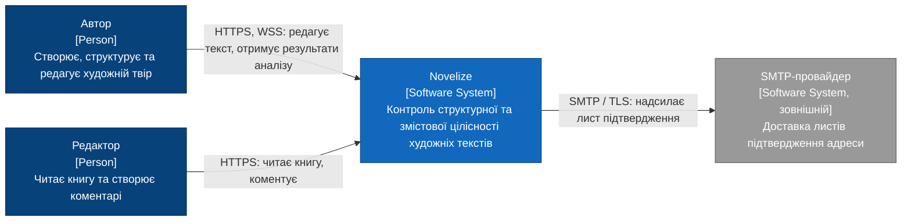
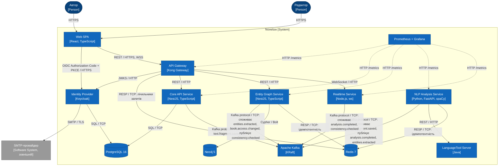
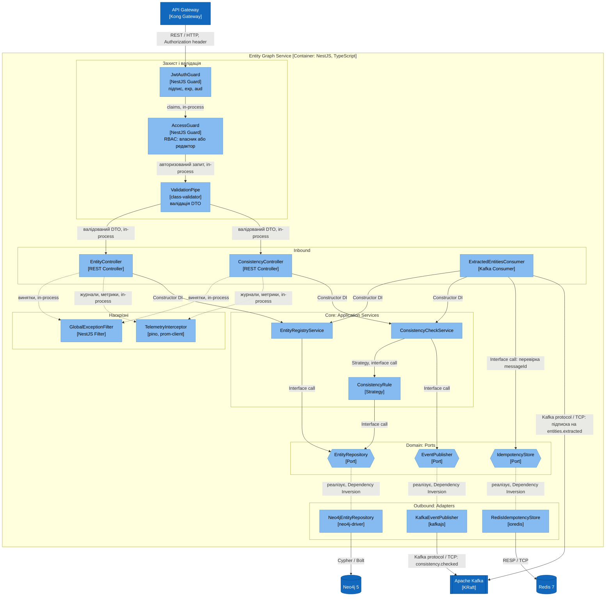

# Розділ 2. Проєктування архітектури системи

Вимоги: [srs.md](./srs.md). Рішення: [ADR-001](./adr/0001-choice-of-technology.md).

## 2.1 Контекстне та контейнерне моделювання системи (C4 Model)

### Рівень 1. System Context

| Елемент | Опис | Вимоги |
|---|---|---|
| Автор | Основний актор: ієрархія твору, сутності, запуск аналізу | [FUN-01](./srs.md#srs-fun-01), [FUN-07](./srs.md#srs-fun-07) |
| Редактор | Роль із правами читання та коментування | [FUN-10](./srs.md#srs-fun-10) |
| Novelize | Система в межах Scope | [srs.md, розділ 1](./srs.md) |
| SMTP-провайдер | Зовнішній сервіс листів підтвердження | [FUN-02](./srs.md#srs-fun-02) |

### Рівень 2. Container Diagram

| Контейнер | Відповідальність | Вимоги |
|---|---|---|
| Web SPA | Інтерфейс редагування; отримання результатів | [FUN-17](./srs.md#srs-fun-17) |
| API Gateway | Перевірка JWT, Rate Limiting, маршрутизація | [SEC-01](./srs.md#srs-nfr-sec-01), [SEC-02](./srs.md#srs-nfr-sec-02) |
| Identity Provider | Реєстрація, підтвердження, OAuth 2.0 / OIDC, видача JWT | [FUN-01…04](./srs.md#srs-fun-01), [SEC-01](./srs.md#srs-nfr-sec-01) |
| Core API Service | Ієрархія, версії, профіль, ролі, видалення та експорт даних, Outbox Relay | [FUN-05…10](./srs.md#srs-fun-05), [FUN-13](./srs.md#srs-fun-13), [REL-02](./srs.md#srs-nfr-rel-02) |
| Entity Graph Service | Реєстр сутностей, хронологія, перевірка узгодженості | [FUN-11, 12, 16](./srs.md#srs-fun-11) |
| NLP Analysis Service | Мовна перевірка, стилістика, виділення згадок | [FUN-14, 15](./srs.md#srs-fun-14), [REL-04](./srs.md#srs-nfr-rel-04) |
| LanguageTool Server | Правила граматики та пунктуації | [FUN-13](./srs.md#srs-fun-13) |
| Realtime Service | WebSocket/SSE-доставка | [FUN-17](./srs.md#srs-fun-17), [PERF-03](./srs.md#srs-nfr-perf-03) |
| Apache Kafka | Асинхронний обмін подіями, DLT | [ADR-001](./adr/0001-choice-of-technology.md) |
| PostgreSQL | Реляційні дані, outbox | [FUN-07, 08](./srs.md#srs-fun-07) |
| Neo4j | Граф сутностей | [FUN-11, 12](./srs.md#srs-fun-11) |
| Redis | Лічильники, ідемпотентність | [SEC-02](./srs.md#srs-nfr-sec-02), [REL-02](./srs.md#srs-nfr-rel-02) |
| Prometheus + Grafana | Метрики | [FUN-18](./srs.md#srs-fun-18) |

Кожен зв'язок рівня 2 має протокол у третьому аргументі `Rel`. Топіки Kafka: `text.fragment.saved`, `analysis.completed`, `entities.extracted`, `consistency.checked`, `book.access.changed`.

## 2.2 Компонентне моделювання критичного сервісу системи (C4 Level 3)

Обрано контейнер **Entity Graph Service** (NestJS, TypeScript): реалізує графову перевірку узгодженості, що відрізняє Novelize від аналогів (розділ 1.3).

| Компонент | Шар | Роль і взаємодія | Вимоги |
|---|---|---|---|
| JwtAuthGuard | Захист | Перевіряє підпис RS256, `exp`, `aud`; 401 при невдачі | [SEC-01](./srs.md#srs-nfr-sec-01) |
| AccessGuard | Захист | RBAC: доступ до `bookId` лише власнику або редактору (локальна копія ACL з `book.access.changed`) | [SEC-06](./srs.md#srs-nfr-sec-06), [FUN-10](./srs.md#srs-fun-10) |
| ValidationPipe | Валідація | Відхиляє невалідні DTO кодом 400 | [SEC-03](./srs.md#srs-nfr-sec-03) |
| GlobalExceptionFilter | Наскрізний | Єдиний формат помилок без внутрішніх деталей | [SEC-03](./srs.md#srs-nfr-sec-03) |
| TelemetryInterceptor | Наскрізний | JSON-журнали з `correlationId`, метрики `/metrics` | [OBS-01](./srs.md#srs-nfr-obs-01), [FUN-18](./srs.md#srs-fun-18) |
| EntityController, ConsistencyController | Inbound | REST-ендпоінти; містять лише маршрутизацію | [FUN-11, 12, 16](./srs.md#srs-fun-11) |
| ExtractedEntitiesConsumer | Inbound | Споживає `entities.extracted`; пропускає дублікати за `messageId` | [FUN-15](./srs.md#srs-fun-15), [REL-02](./srs.md#srs-nfr-rel-02) |
| EntityRegistryService | Core | Правила реєстру сутностей і хронології | [FUN-11, 12](./srs.md#srs-fun-11) |
| ConsistencyCheckService | Core | Виконує набір правил, формує звіт, публікує подію | [FUN-16](./srs.md#srs-fun-16), [PERF-04](./srs.md#srs-nfr-perf-04) |
| ConsistencyRule | Domain | Інтерфейс Strategy; реалізації: атрибути персонажа, хронологія подій, розташування дії | [FUN-16](./srs.md#srs-fun-16) |
| EntityRepository, EventPublisher, IdempotencyStore | Ports | Інтерфейси в доменному шарі; домен не залежить від драйверів | Dependency Inversion |
| Neo4jEntityRepository, KafkaEventPublisher, RedisIdempotencyStore | Outbound | Адаптери портів, інжектуються через DI | [ADR-001](./adr/0001-choice-of-technology.md) |

Напрям залежностей: Controller → Application Service → Domain (порти) ← Adapter. Контролери не мають доступу до `Neo4jEntityRepository`.

## 2.3 Документування архітектурних рішень (Architecture Decision Records)

| ADR | Назва | Статус |
|---|---|---|
| [ADR-001](./adr/0001-choice-of-technology.md) | Вибір брокера повідомлень: Apache Kafka | Approved |