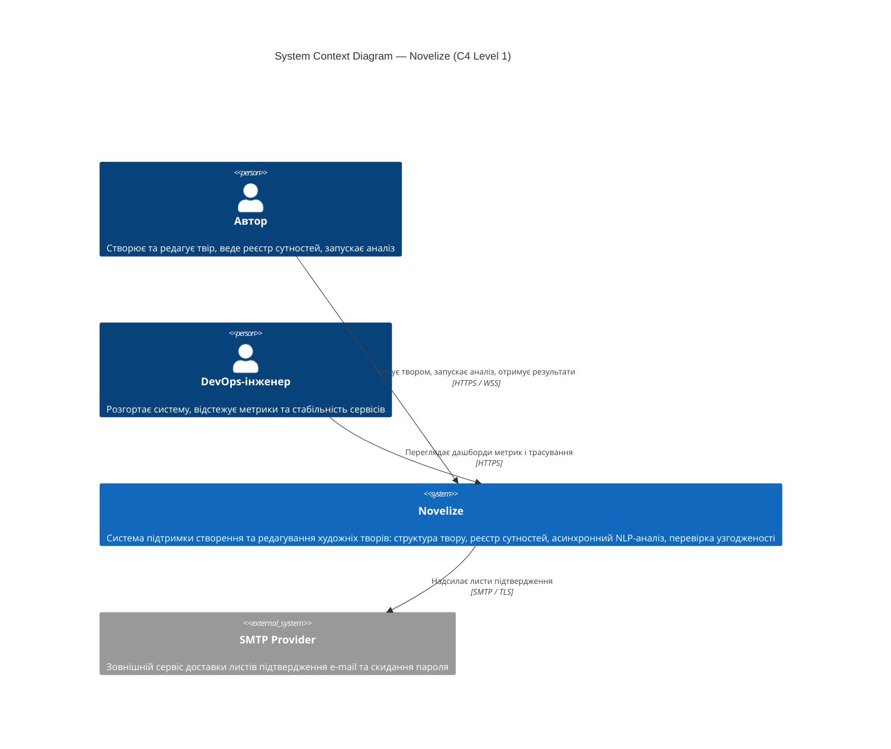
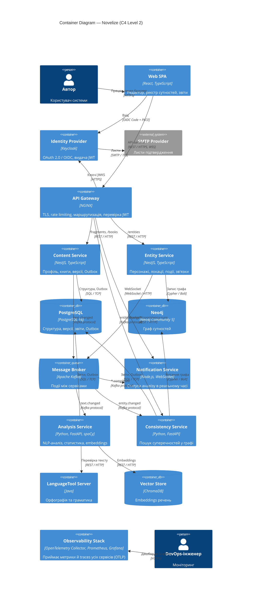
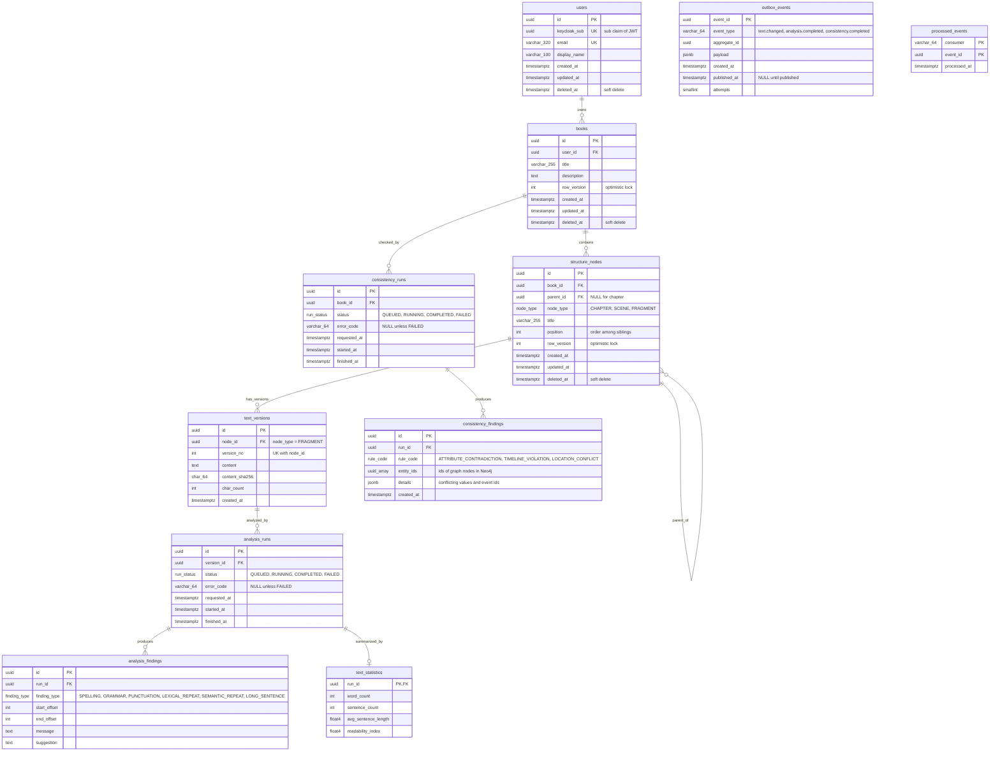
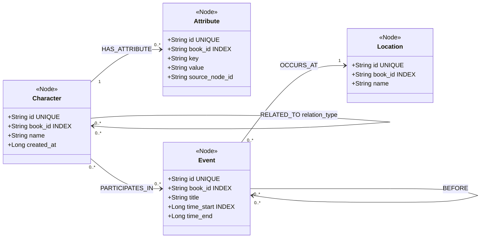
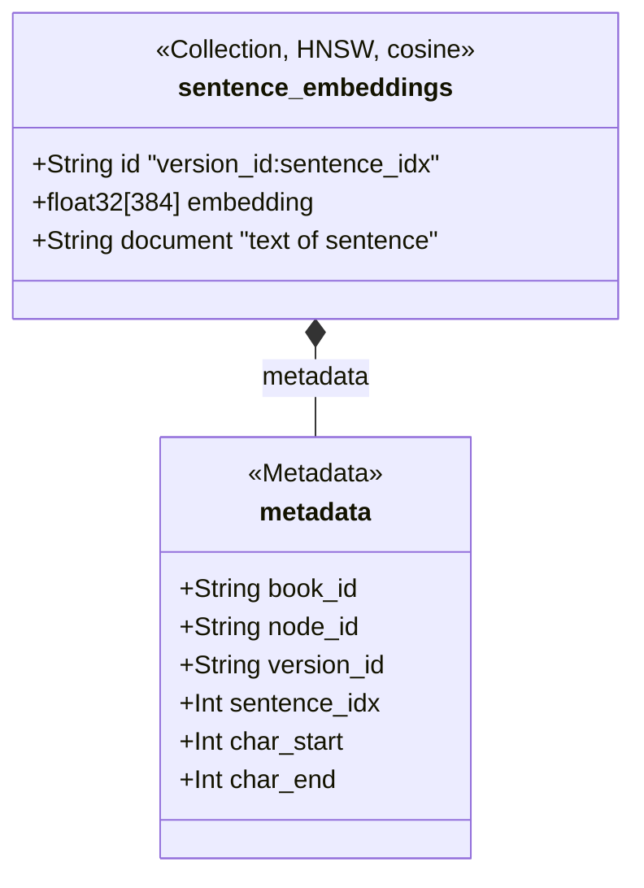
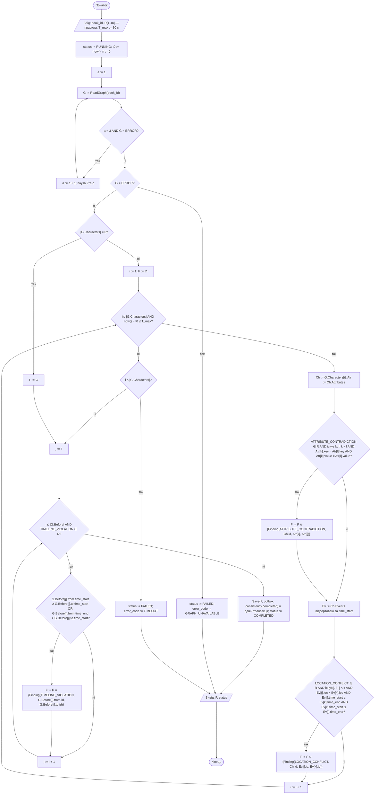
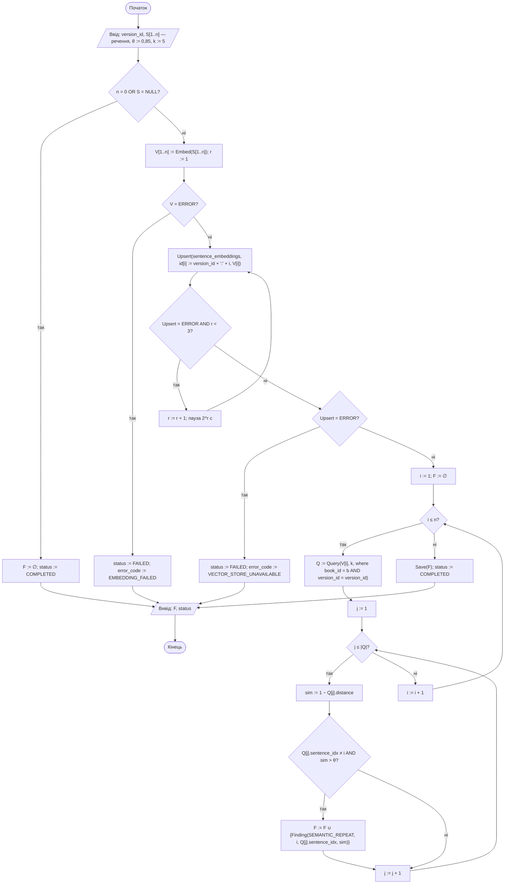
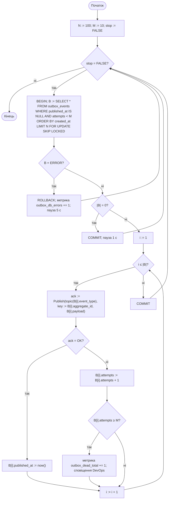

# Розділ 2. Проєктування архітектури системи

Архітектура описана за моделлю C4 (рівні Context, Container, Component) у форматі Diagrams-as-Code (Mermaid.js). Кожен елемент трасується до вимог у [srs.md](./srs.md), а ключовий компроміс зафіксовано в [ADR-001](./adr/0001-choice-of-technology.md).

## 2.1 Контекстне та контейнерне моделювання системи (C4 Model)

### Рівень 1. System Context Diagram

| Елемент | Тип | Опис | Трасування |
|---|---|---|---|
| Автор | Person | Створює й редагує твір, веде реєстр сутностей, запускає аналіз | [SRS-FUN-01](./srs.md#srs-fun-01) … [SRS-FUN-16](./srs.md#srs-fun-16) |
| DevOps-інженер | Person | Переглядає дашборди метрик і трасування | [SRS-NFR-OBS-01](./srs.md#srs-nfr-obs-01) |
| Novelize | System | Система підтримки створення та редагування художніх творів | [srs.md](./srs.md) |
| SMTP Provider | System_Ext | Доставка листів підтвердження адреси електронної пошти | [SRS-FUN-01](./srs.md#srs-fun-01) |

| Зв'язок | Протокол |
|---|---|
| Автор → Novelize | HTTPS, WSS |
| DevOps-інженер → Novelize | HTTPS |
| Novelize → SMTP Provider | SMTP / TLS |

### Рівень 2. Container Diagram

Примітка до діаграми. Для зменшення перетинів стрілок не показано: (а) зв'язок Identity Provider з PostgreSQL (власна схема `keycloak` по JDBC / TCP); (б) експорт метрик і трасування всіх сервісів до Observability Stack протоколом OTLP / gRPC.

| Контейнер | Технологія | Відповідальність | Трасування |
|---|---|---|---|
| Web SPA | React, TypeScript | Інтерфейс редактора, реєстру сутностей і звітів аналізу; приймає WebSocket-повідомлення | [SRS-FUN-03](./srs.md#srs-fun-03), [SRS-FUN-04](./srs.md#srs-fun-04), [SRS-FUN-16](./srs.md#srs-fun-16) |
| API Gateway | NGINX | TLS termination, rate limiting, маршрутизація, перевірка підпису JWT | [SRS-NFR-SEC-01](./srs.md#srs-nfr-sec-01), [SRS-NFR-SEC-02](./srs.md#srs-nfr-sec-02), [SRS-NFR-SEC-03](./srs.md#srs-nfr-sec-03) |
| Identity Provider | Keycloak | Реєстрація, автентифікація OAuth 2.0 / OIDC, видача JWT | [SRS-FUN-01](./srs.md#srs-fun-01), [SRS-FUN-02](./srs.md#srs-fun-02) |
| Content Service | NestJS, TypeScript | Профіль, книги, структура, версії фрагментів, Outbox | [SRS-FUN-03](./srs.md#srs-fun-03), [SRS-FUN-04](./srs.md#srs-fun-04), [SRS-FUN-05](./srs.md#srs-fun-05), [SRS-NFR-REL-02](./srs.md#srs-nfr-rel-02) |
| Entity Service | NestJS, TypeScript | CRUD сутностей і зв'язків твору | [SRS-FUN-06](./srs.md#srs-fun-06), [SRS-FUN-07](./srs.md#srs-fun-07) |
| Analysis Service | Python, FastAPI, spaCy | Асинхронний аналіз тексту, статистика, embeddings | [SRS-FUN-08](./srs.md#srs-fun-08) … [SRS-FUN-13](./srs.md#srs-fun-13), [SRS-NFR-PERF-02](./srs.md#srs-nfr-perf-02) |
| Consistency Service | Python, FastAPI | Виявлення суперечностей у графі сутностей | [SRS-FUN-14](./srs.md#srs-fun-14), [SRS-FUN-15](./srs.md#srs-fun-15), [SRS-NFR-PERF-03](./srs.md#srs-nfr-perf-03) |
| Notification Service | Node.js, WebSocket | Доставка статусів і результатів аналізу в реальному часі | [SRS-FUN-16](./srs.md#srs-fun-16) |
| LanguageTool Server | Java | Правила орфографії, граматики та пунктуації | [SRS-FUN-08](./srs.md#srs-fun-08), [SRS-FUN-09](./srs.md#srs-fun-09) |
| Message Broker | Apache Kafka | Асинхронні події між сервісами | [SRS-NFR-REL-02](./srs.md#srs-nfr-rel-02), [SRS-NFR-SCAL-01](./srs.md#srs-nfr-scal-01) |
| PostgreSQL | PostgreSQL 16 | Профілі, структура книг, версії, звіти, Outbox | [SRS-FUN-04](./srs.md#srs-fun-04), [SRS-FUN-05](./srs.md#srs-fun-05), [SRS-NFR-REL-03](./srs.md#srs-nfr-rel-03) |
| Neo4j | Neo4j Community 5 | Граф сутностей і зв'язків твору | [SRS-FUN-07](./srs.md#srs-fun-07), [ADR-001](./adr/0001-choice-of-technology.md) |
| Vector Store | ChromaDB | Embeddings речень для пошуку смислових повторів | [SRS-FUN-11](./srs.md#srs-fun-11) |
| Observability Stack | OpenTelemetry Collector, Prometheus, Grafana | Збір метрик і трасування, дашборди | [SRS-NFR-OBS-01](./srs.md#srs-nfr-obs-01) |

| Зв'язок | Протокол |
|---|---|
| Автор → Web SPA | HTTPS |
| Web SPA → Identity Provider | OIDC Authorization Code + PKCE / HTTPS |
| Web SPA → API Gateway | REST / HTTPS, WSS |
| API Gateway → Identity Provider | HTTPS (отримання JWKS) |
| Identity Provider → SMTP Provider | SMTP / TLS |
| API Gateway → Content / Entity / Consistency Service | REST / HTTP |
| API Gateway → Notification Service | WebSocket / HTTP |
| Content Service → PostgreSQL, Analysis Service → PostgreSQL | SQL / TCP |
| Entity Service → Neo4j, Consistency Service → Neo4j | Cypher / Bolt |
| Content / Entity Service → Message Broker; Message Broker → Analysis / Consistency / Notification Service | Kafka protocol / TCP |
| Analysis Service → LanguageTool Server, Analysis Service → Vector Store | REST / HTTP |
| DevOps-інженер → Observability Stack | HTTPS |

## 2.2 Компонентне моделювання критичного сервісу системи (C4 Component)

Обрано **Consistency Service**: сервіс реалізує ключову відмінність системи від аналогів — детерміноване виявлення суперечностей графовими запитами ([SRS-FUN-14](./srs.md#srs-fun-14), [SRS-FUN-15](./srs.md#srs-fun-15)). Вибір сховища обґрунтовано в [ADR-001](./adr/0001-choice-of-technology.md).

```mermaid
C4Component
    title Component Diagram — Consistency Service (C4 Level 3)

    Container(gw, "API Gateway", "NGINX", "Маршрутизація, rate limiting")
    ContainerQueue(kafka, "Message Broker", "Apache Kafka", "entity.changed, consistency.completed")
    ContainerDb(neo, "Neo4j", "Neo4j Community 5", "Граф сутностей (read-only роль)")
    ContainerDb(pg, "PostgreSQL", "PostgreSQL 16", "Звіти, outbox, processed_events")

    Container_Boundary(cs, "Consistency Service (Python, FastAPI)") {
        Component(telemetry, "TelemetryMiddleware", "OpenTelemetry SDK", "Метрики, trace-контекст, структуровані логи")
        Component(guard, "JwtAuthGuard", "FastAPI Dependency", "Перевірка підпису, exp, scope та належності книги авторові")
        Component(valid, "RequestValidator", "Pydantic DTO", "Валідація вхідних даних")
        Component(ctrl, "ConsistencyController", "FastAPI Router", "REST: запуск перевірки, читання звіту")
        Component(err, "GlobalExceptionHandler", "FastAPI exception handlers", "Єдиний формат помилок без витоку внутрішніх деталей")
        Component(consumer, "EntityChangedConsumer", "aiokafka", "Споживає entity.changed")
        Component(idem, "IdempotencyGuard", "Application Service", "Відсікає повторну доставку за event_id")
        Component(usecase, "RunConsistencyCheckUseCase", "Application Service", "Оркестрація перевірки книги")
        Component(registry, "RuleRegistry", "Strategy pattern", "Реєстр правил перевірки")
        Component(attrRule, "AttributeContradictionRule", "Domain Service", "Суперечності атрибутів персонажа")
        Component(timeRule, "TimelineLocationRule", "Domain Service", "Часові та просторові суперечності")
        Component(builder, "ReportBuilder", "Domain Service", "Формування звіту суперечностей")
        Component(graphPort, "EntityGraphPort", "Interface (ABC)", "Порт читання графа")
        Component(repoPort, "ReportRepositoryPort", "Interface (ABC)", "Порт збереження звітів та outbox")
        Component(neoAdapter, "Neo4jGraphRepository", "neo4j driver", "Параметризовані Cypher-запити")
        Component(pgAdapter, "PostgresReportRepository", "SQLAlchemy", "Звіти, outbox, processed_events")
        Component(outbox, "OutboxPublisher", "Polling relay, aiokafka", "Публікує події з outbox у Kafka")
    }

    Rel(gw, telemetry, "Передає запит із JWT", "REST / HTTP")
    Rel(telemetry, guard, "Передає запит зі span", "Middleware")
    Rel(guard, valid, "Передає автентифікований запит", "Виклик у процесі")
    Rel(valid, ctrl, "Передає валідний DTO", "Виклик у процесі")
    Rel(ctrl, usecase, "Запускає перевірку", "Dependency Injection")
    Rel(err, ctrl, "Перехоплює винятки", "Middleware")

    Rel(kafka, consumer, "Доставка entity.changed", "Kafka protocol / TCP")
    Rel(consumer, idem, "Перевіряє event_id", "Виклик у процесі")
    Rel(idem, usecase, "Передає нову подію", "Dependency Injection")

    Rel(usecase, registry, "Отримує правила", "Виклик у процесі")
    Rel(registry, attrRule, "Містить правило", "Strategy")
    Rel(registry, timeRule, "Містить правило", "Strategy")
    Rel(attrRule, graphPort, "Читає граф", "Виклик через інтерфейс")
    Rel(timeRule, graphPort, "Читає граф", "Виклик через інтерфейс")
    Rel(usecase, builder, "Передає результати правил", "Виклик у процесі")
    Rel(usecase, repoPort, "Зберігає звіт та outbox", "Виклик через інтерфейс")

    Rel(neoAdapter, graphPort, "Реалізує порт", "Dependency Inversion")
    Rel(pgAdapter, repoPort, "Реалізує порт", "Dependency Inversion")
    Rel(neoAdapter, neo, "Cypher-запити (read-only)", "Bolt / TCP")
    Rel(pgAdapter, pg, "Запис звітів і outbox", "SQL / TCP")
    Rel(outbox, pg, "Читає непублікований outbox", "SQL / TCP")
    Rel(outbox, kafka, "Публікує consistency.completed", "Kafka protocol / TCP")

    UpdateLayoutConfig($c4ShapeInRow="4", $c4BoundaryInRow="1")
```

Залежності спрямовані до ядра: контролер і споживач викликають `RunConsistencyCheckUseCase`, який знає лише порти (`EntityGraphPort`, `ReportRepositoryPort`); адаптери реалізують порти (Dependency Inversion), тому доменні правила не залежать від Neo4j, PostgreSQL чи Kafka.

| Компонент | Шар | Роль і патерн | Трасування |
|---|---|---|---|
| TelemetryMiddleware | Inbound | Метрики, trace-контекст, структуровані логи (OpenTelemetry) | [SRS-NFR-OBS-01](./srs.md#srs-nfr-obs-01) |
| JwtAuthGuard | Inbound | Перевірка підпису, строку дії, scope та належності книги авторові (RBAC) | [SRS-NFR-SEC-01](./srs.md#srs-nfr-sec-01) |
| RequestValidator | Inbound | Валідація вхідних даних (Pydantic DTO) | [SRS-NFR-SEC-04](./srs.md#srs-nfr-sec-04) |
| ConsistencyController | Inbound | REST-ендпоінти запуску перевірки та читання звіту | [SRS-FUN-14](./srs.md#srs-fun-14), [SRS-FUN-15](./srs.md#srs-fun-15) |
| GlobalExceptionHandler | Inbound | Єдиний формат помилок без витоку внутрішніх деталей | [SRS-NFR-SEC-04](./srs.md#srs-nfr-sec-04) |
| EntityChangedConsumer | Inbound | Споживач події `entity.changed` | [SRS-NFR-REL-02](./srs.md#srs-nfr-rel-02) |
| IdempotencyGuard | Application | Відсікання повторної доставки за `event_id` (таблиця `processed_events`) | [SRS-NFR-REL-02](./srs.md#srs-nfr-rel-02) |
| RunConsistencyCheckUseCase | Application | Оркестрація перевірки книги | [SRS-FUN-14](./srs.md#srs-fun-14), [SRS-FUN-15](./srs.md#srs-fun-15) |
| RuleRegistry | Domain | Реєстр правил (Strategy) | [SRS-FUN-14](./srs.md#srs-fun-14), [SRS-FUN-15](./srs.md#srs-fun-15) |
| AttributeContradictionRule | Domain | Суперечності атрибутів персонажа | [SRS-FUN-14](./srs.md#srs-fun-14) |
| TimelineLocationRule | Domain | Часові та просторові суперечності | [SRS-FUN-15](./srs.md#srs-fun-15) |
| ReportBuilder | Domain | Формування звіту суперечностей | [SRS-FUN-14](./srs.md#srs-fun-14), [SRS-FUN-15](./srs.md#srs-fun-15) |
| EntityGraphPort, ReportRepositoryPort | Ports | Інтерфейси (ABC), від яких залежить ядро | [ADR-001](./adr/0001-choice-of-technology.md) |
| Neo4jGraphRepository | Outbound | Параметризовані Cypher-запити (Bolt), read-only роль | [SRS-NFR-PERF-03](./srs.md#srs-nfr-perf-03), [ADR-001](./adr/0001-choice-of-technology.md) |
| PostgresReportRepository | Outbound | Збереження звітів, outbox, `processed_events` (SQLAlchemy) | [SRS-NFR-REL-02](./srs.md#srs-nfr-rel-02) |
| OutboxPublisher | Outbound | Polling relay: публікація подій `consistency.completed` у Kafka | [SRS-NFR-REL-02](./srs.md#srs-nfr-rel-02) |

## 2.3 Документування архітектурних рішень (ADR)

| Номер | Назва | Статус |
|---|---|---|
| [ADR-001](./adr/0001-choice-of-technology.md) | Вибір СУБД для графа сутностей та перевірки узгодженості | Approved |

## 2.4. Проєктування та моделювання баз даних

Шар даних складається з трьох сховищ, визначених у [контейнерній діаграмі](#diagram-level2): PostgreSQL 16 (реляційна модель), Neo4j Community 5 (property graph, [ADR-001](./adr/0001-choice-of-technology.md)) та ChromaDB (колекція embeddings). Вимоги: [SRS-FUN-04](./srs.md#srs-fun-04), [SRS-FUN-05](./srs.md#srs-fun-05), [SRS-FUN-07](./srs.md#srs-fun-07), [SRS-FUN-11](./srs.md#srs-fun-11), [SRS-FUN-14](./srs.md#srs-fun-14), [SRS-FUN-15](./srs.md#srs-fun-15), [SRS-NFR-REL-02](./srs.md#srs-nfr-rel-02).

### 2.4.1. PostgreSQL 16: ERD

Типи `node_type`, `run_status`, `finding_type`, `rule_code` — PostgreSQL ENUM. Типи `varchar_N` і `char_64` на діаграмі відповідають `varchar(N)` і `char(64)` (обмеження синтаксису Mermaid). Таблиці розподілені за схемами-власниками: `content` (users, books, structure_nodes, text_versions, outbox_events), `analysis` (analysis_runs, analysis_findings, text_statistics, outbox_events, processed_events), `consistency` (consistency_runs, consistency_findings, outbox_events, processed_events). Кожен сервіс має власну схему й власну пару таблиць `outbox_events` та `processed_events`; зовнішні ключі між схемами не створюються, посилання між схемами — логічні (UUID).

**users**

| Поле | Тип | Обмеження | Опис |
|---|---|---|---|
| id | uuid | PK | Ідентифікатор користувача |
| keycloak_sub | uuid | UNIQUE, NOT NULL | Claim `sub` з JWT |
| email | varchar(320) | UNIQUE, NOT NULL | Адреса електронної пошти |
| display_name | varchar(100) | NOT NULL | Відображуване ім'я |
| created_at, updated_at | timestamptz | NOT NULL, DEFAULT now() | Службові часові мітки |
| deleted_at | timestamptz | NULL | Soft delete; фізичне видалення не пізніше 30 днів ([SRS-NFR-SEC-05](./srs.md#srs-nfr-sec-05)) |

**books**

| Поле | Тип | Обмеження | Опис |
|---|---|---|---|
| id | uuid | PK | Ідентифікатор книги |
| user_id | uuid | FK → users.id, NOT NULL | Власник |
| title | varchar(255) | NOT NULL | Назва |
| description | text | NULL | Опис |
| row_version | int | NOT NULL, DEFAULT 1 | Оптимістичне блокування |
| created_at, updated_at, deleted_at | timestamptz | див. users | Службові поля |

**structure_nodes**

| Поле | Тип | Обмеження | Опис |
|---|---|---|---|
| id | uuid | PK | Вузол ієрархії |
| book_id | uuid | FK → books.id, NOT NULL | Книга |
| parent_id | uuid | FK → structure_nodes.id, NULL | Батьківський вузол; NULL для розділу |
| node_type | node_type | NOT NULL | CHAPTER, SCENE, FRAGMENT |
| title | varchar(255) | NOT NULL | Назва |
| position | int | NOT NULL, CHECK (position ≥ 0) | Порядок серед дочірніх вузлів |
| row_version | int | NOT NULL, DEFAULT 1 | Оптимістичне блокування |
| created_at, updated_at, deleted_at | timestamptz | див. users | Службові поля |

**text_versions**

| Поле | Тип | Обмеження | Опис |
|---|---|---|---|
| id | uuid | PK | Версія |
| node_id | uuid | FK → structure_nodes.id, NOT NULL | Вузол типу FRAGMENT |
| version_no | int | NOT NULL, UNIQUE (node_id, version_no) | Порядковий номер версії |
| content | text | NOT NULL, CHECK (char_length(content) BETWEEN 1 AND 50000) | Текст |
| content_sha256 | char(64) | NOT NULL | Хеш для пропуску ідентичних версій |
| char_count | int | NOT NULL | Кількість символів |
| created_at | timestamptz | NOT NULL | Час збереження |

Зберігаються останні 50 версій ([SRS-FUN-05](./srs.md#srs-fun-05)): у транзакції збереження видаляються рядки з `version_no` ≤ `max(version_no)` − 50.

**analysis_runs**

| Поле | Тип | Обмеження | Опис |
|---|---|---|---|
| id | uuid | PK | Запуск аналізу |
| version_id | uuid | FK → text_versions.id, NOT NULL | Проаналізована версія |
| status | run_status | NOT NULL | QUEUED, RUNNING, COMPLETED, FAILED |
| error_code | varchar(64) | CHECK (status = 'FAILED' OR error_code IS NULL) | EMBEDDING_FAILED, VECTOR_STORE_UNAVAILABLE |
| requested_at, started_at, finished_at | timestamptz | requested_at NOT NULL | Часові мітки |

**analysis_findings**

| Поле | Тип | Обмеження | Опис |
|---|---|---|---|
| id | uuid | PK | Знахідка |
| run_id | uuid | FK → analysis_runs.id, NOT NULL | Запуск |
| finding_type | finding_type | NOT NULL | SPELLING, GRAMMAR, PUNCTUATION, LEXICAL_REPEAT, SEMANTIC_REPEAT, LONG_SENTENCE |
| start_offset, end_offset | int | NOT NULL, CHECK (end_offset > start_offset) | Межі в `content` |
| message | text | NOT NULL | Опис проблеми |
| suggestion | text | NULL | Варіант виправлення |

**text_statistics** (зв'язок 1 : 0..1 з analysis_runs; рядок існує лише для статусу COMPLETED)

| Поле | Тип | Обмеження | Опис |
|---|---|---|---|
| run_id | uuid | PK, FK → analysis_runs.id | Запуск |
| word_count, sentence_count | int | NOT NULL, ≥ 0 | Кількість слів і речень |
| avg_sentence_length | float4 | NOT NULL | Середня довжина речення, слів |
| readability_index | float4 | NOT NULL | Індекс читабельності |

**consistency_runs**

| Поле | Тип | Обмеження | Опис |
|---|---|---|---|
| id | uuid | PK | Запуск перевірки |
| book_id | uuid | NOT NULL (логічне посилання на content.books) | Книга |
| status | run_status | NOT NULL | QUEUED, RUNNING, COMPLETED, FAILED |
| error_code | varchar(64) | CHECK (error_code IN ('GRAPH_UNAVAILABLE', 'TIMEOUT')) | Лише для FAILED |
| requested_at, started_at, finished_at | timestamptz | requested_at NOT NULL | Часові мітки |

**consistency_findings**

| Поле | Тип | Обмеження | Опис |
|---|---|---|---|
| id | uuid | PK | Суперечність |
| run_id | uuid | FK → consistency_runs.id, NOT NULL | Запуск |
| rule_code | rule_code | NOT NULL | ATTRIBUTE_CONTRADICTION, TIMELINE_VIOLATION, LOCATION_CONFLICT |
| entity_ids | uuid[] | NOT NULL, CHECK (cardinality(entity_ids) ≥ 1) | Ідентифікатори вузлів Neo4j |
| details | jsonb | NOT NULL | Конфліктні значення та події |
| created_at | timestamptz | NOT NULL | Час створення |

**outbox_events**

| Поле | Тип | Обмеження | Опис |
|---|---|---|---|
| event_id | uuid | PK | Ідентифікатор події (ключ ідемпотентності) |
| event_type | varchar(64) | NOT NULL | text.changed, analysis.completed, consistency.completed |
| aggregate_id | uuid | NOT NULL | Ключ партиції Kafka |
| payload | jsonb | NOT NULL | Тіло події |
| created_at | timestamptz | NOT NULL | Час створення |
| published_at | timestamptz | NULL | NULL до публікації |
| attempts | smallint | NOT NULL, DEFAULT 0 | Кількість невдалих публікацій |

**processed_events**: PK (consumer, event_id); `processed_at timestamptz NOT NULL`. Забезпечує ідемпотентне споживання ([SRS-NFR-REL-02](./srs.md#srs-nfr-rel-02)).

**План індексування**

| Таблиця | Індекс | Тип | Запит, що оптимізується |
|---|---|---|---|
| users | (keycloak_sub); (email) | UNIQUE B-tree | Пошук користувача за JWT |
| books | (user_id, created_at DESC) WHERE deleted_at IS NULL | B-tree, частковий | Перелік книг автора |
| structure_nodes | (book_id, parent_id, position) WHERE deleted_at IS NULL | UNIQUE B-tree, частковий | Читання дерева та порядку елементів |
| text_versions | (node_id, version_no DESC) | UNIQUE B-tree | Остання версія й відновлення |
| analysis_runs | (version_id, requested_at DESC); (status) WHERE status IN ('QUEUED','RUNNING') | B-tree, частковий | Статус аналізу; активні завдання |
| analysis_findings | (run_id, finding_type) | B-tree | Звіт аналізу за типом |
| consistency_runs | (book_id, requested_at DESC); UNIQUE (book_id) WHERE status IN ('QUEUED','RUNNING') | B-tree, UNIQUE частковий | Історія; не більше однієї активної перевірки (відповідь 409) |
| consistency_findings | (run_id, rule_code); (entity_ids) | B-tree; GIN | Звіт за правилом; пошук за сутністю |
| outbox_events | (created_at) WHERE published_at IS NULL AND attempts < 10 | B-tree, частковий | Вибірка непублікованих подій (алгоритм 2.6.3) |

### 2.4.2. Neo4j: схема графа сутностей

| Елемент | Властивості | Обмеження та індекси |
|---|---|---|
| (:Character) | id, book_id, name, created_at | UNIQUE (id); INDEX (book_id); INDEX (book_id, name) |
| (:Attribute) | id, book_id, key, value, source_node_id | UNIQUE (id); INDEX (book_id); source_node_id — ідентифікатор фрагмента PostgreSQL |
| (:Event) | id, book_id, title, time_start, time_end | UNIQUE (id); INDEX (book_id); RANGE INDEX (time_start); перевірка time_end ≥ time_start на рівні сервісу |
| (:Location) | id, book_id, name | UNIQUE (id); INDEX (book_id) |
| [:HAS_ATTRIBUTE] | Character → Attribute | 1 : 0..* |
| [:RELATED_TO] | Character → Character; relation_type | M : N |
| [:PARTICIPATES_IN] | Character → Event | M : N |
| [:OCCURS_AT] | Event → Location | кожна подія має рівно одну локацію |
| [:BEFORE] | Event → Event | хронологічний порядок залежних подій |

Усі `id` — UUID у текстовому поданні, збігаються з `entity_ids` у `consistency_findings`. Видалення книги каскадується подією з PostgreSQL ([ADR-001](./adr/0001-choice-of-technology.md), розділ Consequences).

### 2.4.3. ChromaDB: колекція embeddings

| Параметр | Значення |
|---|---|
| Колекція | `sentence_embeddings` |
| Розмірність вектора | 384 (модель paraphrase-multilingual-MiniLM-L12-v2) |
| Метрика | cosine; `similarity := 1 − distance` |
| Індекс | HNSW (параметри за замовчуванням: M = 16, ef_construction = 100, ef_search = 10) |
| Ключ | `{version_id}:{sentence_idx}` |
| Фільтр запиту | `where {book_id, version_id}` |
| Поріг смислового повтору | similarity > 0,85 ([SRS-FUN-11](./srs.md#srs-fun-11)) |

## 2.5. Специфікація міжсервісних контрактів (API)

Контракт описує взаємодію контейнерів Web SPA → API Gateway → Content Service та Consistency Service ([контейнерна діаграма](#diagram-level2)). Деталізовану специфікацію ендпоінтів у форматі OpenAPI 3.0 зафіксовано у файлі [openapi.yaml](./api/openapi.yaml).

| Метод і шлях | Контейнер-виконавець | Успіх | Вимога |
|---|---|---|---|
| POST /fragments/{fragmentId}/versions | Content Service | 201 | [SRS-FUN-05](./srs.md#srs-fun-05) |
| POST /books/{bookId}/consistency-runs | Consistency Service | 202 | [SRS-FUN-14](./srs.md#srs-fun-14), [SRS-FUN-15](./srs.md#srs-fun-15) |
| GET /books/{bookId}/consistency-runs/{runId} | Consistency Service | 200 | [SRS-FUN-14](./srs.md#srs-fun-14) |
| GET /books/{bookId}/consistency-runs/{runId}/findings | Consistency Service | 200 | [SRS-FUN-15](./srs.md#srs-fun-15) |

Авторизація: схема `bearerAuth` (JWT RS256, строк дії не більше 15 хв, [SRS-NFR-SEC-01](./srs.md#srs-nfr-sec-01)). Помилки повертаються у форматі `application/problem+json` (RFC 9457): 400 (валідація), 401, 403, 404, 409 (застаріла `base_version_no` або активна перевірка), 413, 429 із заголовком `Retry-After` ([SRS-NFR-SEC-03](./srs.md#srs-nfr-sec-03)), 500, 503. Перелічені в OpenAPI значення `RunStatus` і `RuleCode` збігаються з ENUM у PostgreSQL (розділ 2.4.1).

## 2.6. Моделювання логіки критичних вузлів

Обрано три алгоритми: перевірка узгодженості (ядро [Consistency Service](#diagram-level3)), виявлення смислових повторів ([SRS-FUN-11](./srs.md#srs-fun-11)) та публікація подій з outbox ([SRS-NFR-REL-02](./srs.md#srs-nfr-rel-02)). Позначення: `:=` — присвоювання, `=` — порівняння, `∅` — порожня множина, `|X|` — кількість елементів, `X[i]` — елемент масиву.

### 2.6.1. Алгоритм перевірки узгодженості книги

Вхід: `book_id`, масив правил `R[1..m]`, ліміт часу `T_max := 30 с`. Вихід: множина знахідок `F`, статус.

1. `status := RUNNING`; `t0 := now()`.
2. Прочитати граф `G := ReadGraph(book_id)`; при помилці повторити не більше 3 викликів із паузою 2^a с; якщо помилка зберігається, `status := FAILED`, `error_code := GRAPH_UNAVAILABLE`.
3. Якщо `|G.Characters| = 0`, `F := ∅` і перейти до кроку 6.
4. Для `i := 1..|G.Characters|`, поки `now() − t0 ≤ T_max`: якщо `ATTRIBUTE_CONTRADICTION ∈ R` AND існують `k ≠ l`, для яких `Atr[k].key = Atr[l].key` AND `Atr[k].value ≠ Atr[l].value`, додати знахідку; якщо `LOCATION_CONFLICT ∈ R` AND існують `j < k`, для яких `Ev[j].loc ≠ Ev[k].loc` AND `Ev[j].time_start ≤ Ev[k].time_end` AND `Ev[k].time_start ≤ Ev[j].time_end`, додати знахідку.
5. Якщо цикл перервано за `T_max`, `status := FAILED`, `error_code := TIMEOUT`.
6. Для `j := 1..|G.Before|`, якщо `TIMELINE_VIOLATION ∈ R` AND (`from.time_start ≥ to.time_start` OR `from.time_end > to.time_start`), додати знахідку.
7. Зберегти `F` і подію `consistency.completed` в одній транзакції; `status := COMPLETED`.

### 2.6.2. Алгоритм виявлення смислових повторів

Вхід: `version_id`, масив речень `S[1..n]`, поріг `θ := 0,85`, `k := 5`. Вихід: `F`, статус.

1. Якщо `n = 0` OR `S = NULL`, `F := ∅`, `status := COMPLETED`.
2. `V[1..n] := Embed(S[1..n])`; при помилці `status := FAILED`, `error_code := EMBEDDING_FAILED`.
3. Записати `V[i]` у колекцію `sentence_embeddings` з ключем `version_id + ':' + i`; при помилці повторити не більше 3 викликів, далі `error_code := VECTOR_STORE_UNAVAILABLE`.
4. Для `i := 1..n`: `Q := Query(V[i], k)` з фільтром `book_id` AND `version_id`; для `j := 1..|Q|`: `sim := 1 − Q[j].distance`; якщо `Q[j].sentence_idx ≠ i` AND `sim > θ`, додати знахідку `SEMANTIC_REPEAT`.
5. Зберегти `F`; `status := COMPLETED`.

### 2.6.3. Алгоритм публікації подій з outbox

Вхід: розмір пакета `N := 100`, ліміт спроб `M := 10`. Цикл виконується, доки `stop = FALSE` (сигнал завершення процесу).

1. У транзакції вибрати `B` — до `N` рядків `outbox_events` з `published_at IS NULL AND attempts < M`, `ORDER BY created_at`, `FOR UPDATE SKIP LOCKED`.
2. Якщо запит завершився помилкою, `ROLLBACK`, пауза 5 с.
3. Якщо `|B| = 0`, `COMMIT`, пауза 1 с.
4. Для `i := 1..|B|`: опублікувати `B[i].payload` у Kafka з ключем `B[i].aggregate_id`; якщо `ack = OK`, `B[i].published_at := now()`; інакше `B[i].attempts := B[i].attempts + 1`; якщо `B[i].attempts ≥ M`, збільшити метрику `outbox_dead_total` і сповістити DevOps-інженера.
5. `COMMIT`.

Гарантія доставки — at-least-once; дублікати відсікаються `processed_events` на стороні споживача.

## 2.7. Інтеграційний аудит та верифікація цілісності доменів

Перевірено узгодженість трьох артефактів: схема даних (2.4), контракт [openapi.yaml](./api/openapi.yaml) (2.5), алгоритми (2.6) та контейнерна діаграма (2.1).

**Виявлені розбіжності та виправлення**

| № | Розбіжність | Виправлення |
|---|---|---|
| 1 | Маршрути на контейнерній діаграмі (`/profile, /books`, `/consistency`) не збігалися зі шляхами в OpenAPI (`/fragments/...`, `/books/{bookId}/consistency-runs`) | Підписи зв'язків API Gateway → Content / Consistency Service змінено на `/fragments, /books` та `/books/*/consistency-runs` |
| 2 | На контейнерній діаграмі відсутній зв'язок Consistency Service → PostgreSQL, хоча компонентна діаграма та 2.4.1 передбачають збереження звітів і outbox | Додано зв'язок `Consistency Service → PostgreSQL` (SQL / TCP) |
| 3 | Коди помилок алгоритму (`GRAPH_UNAVAILABLE`, `TIMEOUT`) не були обмежені ні в API, ні в БД (вільний `varchar`) | Додано `enum` у `ConsistencyRun.error_code` та `CHECK` у `consistency_runs.error_code`; коди аналізу задокументовано в `analysis_runs` |
| 4 | Зв'язок `text_statistics` з `analysis_runs` було задано як 1 : 1, але рядок існує лише для COMPLETED | Змінено на 1 : 0..1 (`\|\|--o\|`) |
| 5 | Тип `row_version` у `books` (smallint) відрізнявся від `structure_nodes` (int) | Уніфіковано до int |
| 6 | Властивість `Attribute.source_node_id` була відсутня, тоді як алгоритм 2.6.1 і [SRS-FUN-14](./srs.md#srs-fun-14) потребують джерела значення атрибута | Властивість додано в схему графа |

**Результати автоматизованих перевірок (скрипт зіставлення артефактів)**

| Перевірка | Результат |
|---|---|
| `RunStatus` (OpenAPI) = `run_status` (ERD) | збігається |
| `RuleCode` (OpenAPI) = `rule_code` (ERD) | збігається |
| Усі коди правил в алгоритмах ∈ `RuleCode` | так |
| Поля outbox в алгоритмі 2.6.3 ∈ `outbox_events` (ERD) | так |
| Поріг 0,85 в алгоритмі 2.6.2 = [SRS-FUN-11](./srs.md#srs-fun-11) | збігається |
| Максимальний розмір фрагмента: OpenAPI (50 000) = CHECK в `text_versions` | збігається |
| Синтаксична валідність `openapi.yaml` (OpenAPI 3.0.3) | пройдено |

**Висновок (Production Readiness).** Після виправлень 1–6 блокерів не виявлено; специфікації придатні для передачі в Розділ 3. Обмеження, що залишаються: контракт не охоплює API Analysis Service та Entity Service (поза обраними сценаріями); посилання між схемами PostgreSQL і між PostgreSQL та Neo4j — логічні й перевіряються на рівні застосунку.
