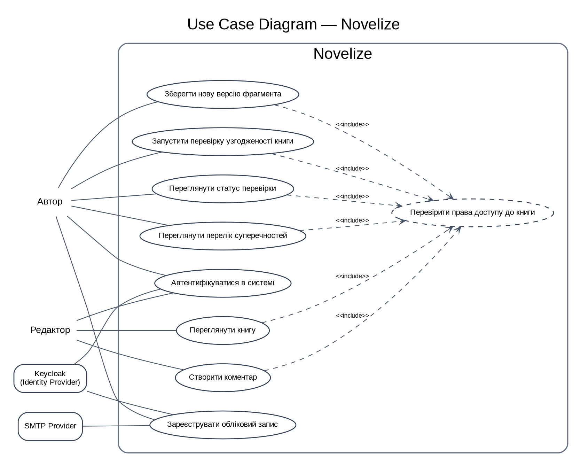

# Лабораторна робота №7. Консолідація архітектурного контуру Novelize

## Вихідні дані та межі виконання

Матеріали підготовлено на основі наявних файлів репозиторію: `docs/srs.md`, `docs/2_design.md`, `docs/api/openapi.yaml`, `docs/adr/0001-choice-of-technology.md`, C4-діаграм рівнів 1–3 та попередніх AI Insights. Назви контейнерів, методи API, типи даних і числові пороги нижче не вигадуються окремо від цих специфікацій.

Novelize — інформаційна система підтримки створення та редагування художніх творів. Її основні можливості: ієрархія «книга → розділ → сцена → фрагмент», незмінні версії фрагментів, реєстр сутностей, асинхронний аналіз тексту та перевірка змістової узгодженості за графом.

**Важливе обмеження:** поточний OpenAPI-контракт описує чотири маршрути для збереження версій фрагментів і перевірки узгодженості. Він не є повною специфікацією всіх маршрутів Content Service, Entity Service, Analysis Service та Identity Provider. У таблицях API наведено лише те, що реально присутнє в `docs/api/openapi.yaml`.

---

# Завдання 1. Текстова експлікація архітектури та патернів

## 1.1. Обґрунтування архітектурного стилю

Для Novelize обрано **розподілену сервісну архітектуру з асинхронною подієвою взаємодією між сервісами**. Клієнтська частина Web SPA взаємодіє з серверними контейнерами через API Gateway. Окремі контейнери відповідають за керування вмістом, сутностями, аналіз тексту, перевірку узгодженості та доставку повідомлень. Для синхронних операцій використовується REST/HTTPS, а для тривалих операцій аналізу — Apache Kafka.

Вибір зумовлений характером навантаження. Збереження фрагмента має завершуватися без очікування орфографічного, стилістичного або графового аналізу. Content Service зберігає нову версію та записує подію до `outbox_events` у межах транзакції PostgreSQL. Outbox Relay передає подію до Kafka. Analysis Service та інші споживачі обробляють її незалежно від HTTP-запиту, а Notification Service доставляє результат клієнту через WebSocket; альтернативним каналом у SRS визначено SSE.

Поділ на контейнери локалізує відповідальність і дозволяє змінювати або масштабувати обчислювальні частини незалежно. Наприклад, збільшення кількості споживачів `text.changed` не потребує зміни Web SPA або Content Service. Водночас поточне еталонне розгортання за SRS складається з однієї машини (4 vCPU, 16 ГБ RAM) та одного екземпляра кожного контейнера. Отже, сервісна декомпозиція створює можливість незалежного масштабування, але сама по собі не гарантує горизонтального масштабування чи високої доступності в поточному одновузловому середовищі.

Архітектура орієнтована на такі вимірювані NFR:

- `SRS-NFR-PERF-01`: синхронні API-операції мають витримувати 500 RPS з `p95 < 200 мс` та часткою помилок меншою за 0,1% у визначеному еталонному середовищі;
- `SRS-NFR-PERF-02`: аналіз фрагмента до 50 000 символів має завершуватися з `p95 ≤ 30 с` за 10 одночасних аналізів;
- `SRS-NFR-PERF-03`: доставка результату аналізу клієнту має вкладатися в `p95 ≤ 1 с` після появи події;
- `SRS-NFR-REL-02`: події передаються за моделлю at-least-once через Outbox Pattern; споживачі мають бути ідемпотентними;
- `SRS-NFR-REL-04`: при недоступності LanguageTool передбачено до трьох повторів із exponential backoff, після чого Circuit Breaker та Dead Letter Topic.

Асинхронний контур відокремлює час відповіді HTTP від часу обробки тексту. Це дозволяє API повернути підтвердження прийняття або створення ресурсу, не утримуючи з'єднання протягом повного NLP-аналізу. Kafka забезпечує зберігання журналу подій, порядок у межах партиції та повторне читання подій у межах retention. В ADR-001 визначено retention 7 діб і ключ партиціювання `fragmentId`.

Архітектурне рішення має обмеження. Kafka розгортається одним брокером із replication factor 1, тому брокер є Single Point of Failure. Таке розгортання не забезпечує повної відмовостійкості, необхідної для безумовної гарантії доступності 99,5%. Ця суперечність має бути відображена у висновках про готовність до production: показник доступності є цільовою вимогою, але не підтвердженим результатом одновузлової топології. Крім того, Kafka збільшує споживання RAM та операційну складність порівняно з RabbitMQ; ADR-001 фіксує, що її обрано заради replay, порядку подій і consumer groups, а не через пропускну здатність.

## 1.2. Патерни проєктування та їх призначення

| Патерн / принцип | Місце застосування | Інженерна проблема, яку вирішує | Межа застосування |
|---|---|---|---|
| **Outbox Pattern** | Content Service, Analysis Service, Consistency Service | Запис бізнес-даних і події в одній транзакції PostgreSQL зменшує ризик ситуації, коли дані збережено, але повідомлення не опубліковано | Доставка at-least-once допускає дублікати; потрібна ідемпотентність споживачів |
| **Repository / Ports and Adapters** | `EntityGraphPort`, `ReportRepositoryPort`, `Neo4jGraphRepository`, `PostgresReportRepository` | Доменний код працює з абстракціями, а не з конкретними драйверами Neo4j чи PostgreSQL | Інтерфейси не повинні перетворюватися на зайві абстракції для кожного простого запиту |
| **Dependency Injection** | Контролери, Use Case, порти та адаптери Consistency Service | Залежності передаються ззовні; Use Case не створює драйвери БД самостійно. Це спрощує ізоляцію та тестування | Конфігурація контейнера залежностей має залишатися централізованою |
| **Strategy** | `RuleRegistry`, `AttributeContradictionRule`, `TimelineLocationRule` | Нове правило перевірки можна додати окремою реалізацією без переписування оркестратора | Кожна стратегія має дотримуватися спільного контракту результату та помилок |
| **Idempotent Consumer** | `EntityChangedConsumer`, `IdempotencyGuard`, `processed_events` | Повторна доставка Kafka-повідомлення не повинна створювати повторний звіт або повторні побічні ефекти | Перевірка і фіксація `event_id` мають бути атомарними щодо результату обробки |
| **DTO / Input Validation** | `RequestValidator`, Pydantic DTO та DTO відповідних NestJS-контролерів | Відокремлює зовнішній payload від внутрішніх моделей і блокує некоректні або зайві поля | Валідація формату не замінює перевірку власника ресурсу та прав доступу |
| **Guard / RBAC** | `JwtAuthGuard`, `AccessGuard`, API Gateway | Перевіряє автентичність токена, роль та доступ до конкретної книги | Перевірка лише ролі без перевірки `bookId` може залишити IDOR/BOLA |
| **Circuit Breaker + Retry** | Клієнт Analysis Service до LanguageTool | Обмежує повторні звернення до несправного зовнішнього сервісу та запобігає каскадному виснаженню ресурсів | Повторювати можна лише безпечні або ідемпотентні операції; після ліміту потрібен DLT та моніторинг |

Повноцінний CQRS у поточних матеріалах не задекларовано. Наявність окремих командних і запитних HTTP-операцій сама по собі не означає реалізацію CQRS із незалежними моделями читання та запису. Також Unit of Work не виділено як окремий компонент у C4 Component Diagram; транзакційні межі описані на рівні репозиторіїв та операцій PostgreSQL. Тому ці патерни не заявляються як реалізовані.

## 1.3. Архітектурні ризики та рішення за результатами аудиту

| ID | Виявлена прогалина | Вплив | Рішення / необхідна дія |
|---|---|---|---|
| AR-01 | Один Kafka broker, replication factor 1 | Відмова брокера зупиняє асинхронну обробку | Залишити як обмеження навчального середовища; у production потрібні репліки та окремий ADR |
| AR-02 | В ADR-001 для ідемпотентності вказано Redis `SET NX EX`, але C4 Component Diagram описує PostgreSQL `processed_events` | Дві різні реалізації одного механізму; неможливо однозначно визначити джерело істини | Узгодити ADR та діаграму. У цьому описі базовим варіантом вважається `processed_events` у PostgreSQL, оскільки Redis відсутній у поточній контейнерній діаграмі |
| AR-03 | Ціль 99,5% доступності не підкріплена одновузловою топологією | Ризик недосягнення NFR-REL-01 | У звіті про готовність відокремити цільову вимогу від фактично гарантованої доступності |
| AR-04 | OpenAPI охоплює лише чотири маршрути | Не можна вважати контракт повною картою всіх сервісів | Позначити межі покриття та додати інші контракти в наступній ітерації |
| AR-05 | SRS-FUN-13 вимагає HTTP 202 після збереження фрагмента, але `POST /fragments/{fragmentId}/versions` у OpenAPI повертає 201 | Формальна розбіжність між вимогою та контрактом | Потрібне рішення власника вимог: 201 для створеної версії з окремим статусом асинхронного аналізу або зміна контракту/SRS. У цій лабораторній сигнатуру OpenAPI не підмінено |
| AR-06 | `POST /books/{bookId}/consistency-runs` створює `QUEUED` та повертає 202, але C4/OpenAPI не визначають явний trigger/подію, яка запускає worker | Може залишитися запуск у стані QUEUED без механізму виконання | Додати окрему специфікацію диспетчеризації (подія/черга або worker), схему payload, retry та DLT; назву події не вигадано в межах цієї роботи |
| AR-07 | В описі Consistency Service посилання на `SRS-NFR-PERF-03` супроводжувалося порогом 3 с для 1000 вузлів, хоча PERF-03 визначає доставку результату за 1 с, а PERF-04 — час перевірки графа | Некоректна трасованість метрики | У `docs/2_design.md` та OpenAPI виправлено посилання на `SRS-NFR-PERF-04` і поріг із SRS: `p95 < 2 с` для графа до 10 000 вершин |
| AR-08 | Частина компонентів Consistency Service була помилково пов'язана з `SRS-FUN-14` та `SRS-FUN-15`, які описують статистику й виділення сутностей, а не перевірку суперечностей | Вимоги не відповідають фактичній відповідальності компонента | Трасування Consistency Service та маршрутів перевірки виправлено на `SRS-FUN-16`; назву ADR-001 у таблиці також узгоджено з фактичною назвою рішення про Kafka |

---

# Завдання 2. Use Case Diagram та специфікації сценаріїв

## 2.1. Межі системи та актори

**Subject:** Novelize.

**Первинні актори:**
- **Автор** — створює та редагує власний твір, зберігає версії фрагментів, запускає перевірку узгодженості та переглядає результати.
- **Редактор** — має доступ лише до читання книги та створення коментарів у межах наданих прав. Редактор не має права змінювати текст.

**Вторинні актори:**
- **Keycloak (Identity Provider)** — виконує OAuth 2.0 / OIDC Authorization Code Flow з PKCE та видає JWT.
- **SMTP Provider** — доставляє листи підтвердження електронної пошти та скидання пароля.

Kafka, PostgreSQL, Neo4j, LanguageTool та ChromaDB є внутрішніми технічними контейнерами/інтеграціями архітектури, а не самостійними користувацькими акторами для цієї діаграми.

## 2.2. UML-діаграма прецедентів

Підготовлено вихідні матеріали діаграми: [`use-cases.puml`](./use-cases.puml) та попередній графічний ескіз [`use-cases-preview.png`](./use-cases-preview.png). Це допоміжна візуалізація для перенесення моделі в CASE-засіб. За вимогою методички фінальний артефакт необхідно відкрити/відтворити у StarUML або іншому спеціалізованому CASE-засобі та експортувати з нього PNG; Graphviz-ескіз не видається за експорт StarUML.

## 2.2. Перелік прецедентів

| ID | Прецедент | Актор | Результат |
|---|---|---|---|
| UC-00 | Зареєструвати обліковий запис | Автор; Keycloak і SMTP Provider — вторинні | Обліковий запис створено, лист підтвердження надіслано |
| UC-01 | Автентифікуватися в системі | Автор, Редактор; Keycloak — вторинний | Користувач отримує чинний JWT access token |
| UC-02 | Зберегти нову версію фрагмента | Автор | Створено незмінну версію; подію збережено в Outbox для асинхронного аналізу |
| UC-03 | Запустити перевірку узгодженості книги | Автор | Створено `consistency_runs` зі статусом `QUEUED` |
| UC-04 | Переглянути статус перевірки | Автор | Отримано поточний статус конкретного запуску |
| UC-05 | Переглянути перелік суперечностей | Автор | Отримано сторінку findings із пагінацією |
| UC-06 | Переглянути книгу та створити коментар | Редактор | Редактор читає книгу та додає коментар, не змінюючи текст |

## 2.3. Use Case Specification UC-02 — Зберегти нову версію фрагмента

| Поле | Специфікація |
|---|---|
| ID та назва | UC-02: Зберегти нову версію фрагмента |
| Первинний актор | Автор |
| Вторинні актори | API Gateway; Kafka як внутрішній брокер подій; Analysis Service та Notification Service як внутрішні споживачі |
| Мета | Зафіксувати новий стан текстового фрагмента та ініціювати асинхронний аналіз без блокування редагування |
| Точка входу | `POST /fragments/{fragmentId}/versions` |
| Вимоги | SRS-FUN-07, SRS-FUN-08, SRS-FUN-13, SRS-NFR-REL-02 |

### Preconditions

**Продуктові:**
1. Автор автентифікований; JWT чинний і містить `sub`, `iss`, `aud`, `exp` та потрібний scope.
2. Фрагмент із `fragmentId` існує та належить книзі, доступ до якої має автор.
3. Якщо запит містить `base_version_no`, це значення відповідає актуальній базовій версії фрагмента.
4. `content` — непорожній UTF-8 рядок довжиною від 1 до 50 000 символів.

**Інфраструктурні:**
1. API Gateway доступний і застосовує TLS та Rate Limiting.
2. PostgreSQL доступний; транзакції та обмеження цілісності активні.
3. Outbox-таблиця доступна для атомарного запису разом із новою версією.
4. Тимчасова недоступність Kafka не повинна втрачати подію: Outbox Relay опублікує її після відновлення брокера.

### Main Success Scenario (Happy Path)

| Крок | Дія актора | Реакція та відповідь системи |
|---:|---|---|
| 1 | Автор надсилає `fragmentId`, `content` та, за наявності, `base_version_no` | Web SPA надсилає HTTPS `POST /api/v1/fragments/{fragmentId}/versions` з `Authorization: Bearer <JWT>` та JSON body |
| 2 | — | NGINX перевіряє TLS-з'єднання, ліміт запитів (100/хв на користувача) та JWT: підпис RS256, `exp`, `iss`, `aud`. Недійсний токен завершує запит із 401; перевищення ліміту — 429 і `Retry-After` |
| 3 | — | Content Service перевіряє DTO: `content` обов'язковий, 1–50 000 символів, `additionalProperties: false`; `fragmentId` має формат UUID |
| 4 | — | Сервіс перевіряє право автора на книгу, до якої належить фрагмент. Перевірка виконується за `sub` із JWT та зв'язком `books.user_id`; чужий ресурс не розкривається |
| 5 | — | Сервіс відкриває транзакцію PostgreSQL, блокує/перевіряє поточний номер версії та порівнює `base_version_no` з актуальним значенням |
| 6 | — | Якщо конфлікту немає, сервіс створює незмінний запис `text_versions` із наступним `version_no`, обчислює `content_sha256` і `char_count` |
| 7 | — | У тій самій транзакції створюється запис `outbox_events` для події `text.changed`, що містить ідентифікатори фрагмента/версії та `messageId`. Транзакція фіксується COMMIT |
| 8 | — | API повертає відповідь згідно з поточним OpenAPI: HTTP 201, `Location` та об'єкт `TextVersion` |
| 9 | — | Outbox Relay вибирає неопубліковані записи пакетами до 100 із `FOR UPDATE SKIP LOCKED`, публікує подію в Kafka з ключем `fragmentId` та позначає `published_at` після підтвердження брокера |
| 10 | — | Analysis Service отримує `text.changed`, перевіряє `event_id` на повторну обробку, запускає перевірку тексту та зберігає результати/подію завершення |
| 11 | — | Notification Service отримує подію завершення та доставляє повідомлення клієнту через WebSocket; клієнт відображає статус аналізу |

### Postconditions

1. У PostgreSQL існує новий незмінний запис `text_versions` із новим `version_no`.
2. Для версії зафіксовано `content_sha256`, `char_count` та `created_at`.
3. У межах тієї самої транзакції створено запис `outbox_events`; після публікації він має `published_at`.
4. Подія доступна в Kafka для споживачів; фактичне завершення аналізу є асинхронним і не є передумовою HTTP-відповіді.
5. У разі недоступності брокера запис Outbox залишається непублікованим і може бути оброблений після відновлення.

### Alternative Flow AF-02A — Конфлікт базової версії

| Поле | Значення |
|---|---|
| Старт із кроку Happy Path | Крок 5 |
| Умова-тригер | `base_version_no` не збігається з актуальним номером версії |
| Повернення | До сценарію UC-02 не повертаємося; користувач має оновити текст і повторити збереження |

| Крок | Дія актора | Реакція та відповідь системи |
|---:|---|---|
| 1 | Автор отримує повідомлення про конфлікт | Content Service виконує ROLLBACK; новий запис `text_versions` та подія Outbox не створюються |
| 2 | Автор оновлює актуальну версію тексту | API повертає HTTP 409 із `Problem` та описом конфлікту |
| 3 | Автор повторно надсилає узгоджений текст | Сценарій починається з кроку 1 після оновлення базової версії |

### Alternative Flow AF-02B — Некоректний бізнес-вміст

| Поле | Значення |
|---|---|
| Старт із кроку Happy Path | Крок 3 |
| Умова-тригер | `content` порожній або перевищує 50 000 символів; запит містить невідомі поля |
| Повернення | Після виправлення даних — до кроку 1 |

| Крок | Дія актора | Реакція та відповідь системи |
|---:|---|---|
| 1 | Автор отримує перелік помилок валідації | DTO-валідація відхиляє payload; сервер не відкриває транзакцію запису |
| 2 | Автор виправляє `content` | API повертає HTTP 400 або 413 для надмірного розміру; тіло відповіді відповідає `Problem` |

### Exception Flow EF-02A — PostgreSQL недоступний під час збереження

| Поле | Значення |
|---|---|
| Умова-тригер | Connection timeout або помилка транзакції PostgreSQL на кроках 5–7 |
| Результат | UC-02 не завершується успішно; жодна часткова версія або подія не повинна залишитися |

| Крок | Дія для UI / користувача | Технічна дія сервера та БД |
|---:|---|---|
| 1 | Автор бачить повідомлення про тимчасову недоступність і можливість повторити запит | Сервер перериває операцію та виконує ROLLBACK; з'єднання повертається в пул лише після перевірки стану |
| 2 | Автор може повторити запит після відновлення | Сервер повертає 503 із `Problem`; клієнт не створює повторний запит автоматично без ключа ідемпотентності |
| 3 | — | Після повтору сервер повторно перевіряє `base_version_no`; унікальні обмеження на номер версії запобігають дублюванню |

### Exception Flow EF-02B — Kafka недоступна після COMMIT

| Поле | Значення |
|---|---|
| Умова-тригер | PostgreSQL успішно зафіксував версію та Outbox, але Kafka недоступна |
| Результат | Збереження версії успішне; асинхронний аналіз очікує відновлення брокера |

| Крок | Дія для UI / користувача | Технічна дія сервера та БД |
|---:|---|---|
| 1 | Автор бачить підтвердження збереження; статус аналізу — «очікує» | Outbox Relay не позначає запис як опублікований; запис залишається в `outbox_events` |
| 2 | Автор може продовжити редагування | Relay повторює публікацію з backoff; після підтвердження Kafka встановлює `published_at` |
| 3 | Автор отримує результат після відновлення | Споживач обробляє повідомлення; `event_id` забезпечує ідемпотентність |

---

## 2.4. Use Case Specification UC-03 — Запустити перевірку узгодженості книги

| Поле | Специфікація |
|---|---|
| ID та назва | UC-03: Запустити перевірку узгодженості книги |
| Первинний актор | Автор |
| Вторинні актори | API Gateway; Consistency Service; PostgreSQL; Kafka; Neo4j |
| Мета | Створити запуск перевірки та отримати його ідентифікатор для подальшого відстеження |
| Точка входу | `POST /books/{bookId}/consistency-runs` |
| Вимоги | SRS-FUN-16, SRS-NFR-PERF-04, SRS-NFR-SEC-01, SRS-NFR-SEC-06 |

### Preconditions

**Продуктові:** автор автентифікований; книга існує; автор є власником книги; набір `rule_codes`, якщо переданий, містить лише підтримувані значення `ATTRIBUTE_CONTRADICTION`, `TIMELINE_VIOLATION`, `LOCATION_CONFLICT`.

**Інфраструктурні:** API Gateway і Consistency Service доступні; PostgreSQL приймає транзакції; Neo4j доступний для читання графа; у системі немає іншого активного запуску для тієї самої книги, якщо це обмеження реалізоване доменною моделлю.

### Main Success Scenario (Happy Path)

| Крок | Дія актора | Реакція та відповідь системи |
|---:|---|---|
| 1 | Автор надсилає запит на перевірку книги з необов'язковим `rule_codes` | Web SPA виконує `POST /api/v1/books/{bookId}/consistency-runs` з Bearer JWT |
| 2 | — | API Gateway перевіряє JWT RS256, `exp`, `iss`, `aud`, rate limit та маршрутизує запит до Consistency Service |
| 3 | — | Pydantic DTO перевіряє UUID `bookId`, унікальність значень `rule_codes` та відповідність enum; невідомі поля відхиляються |
| 4 | — | `JwtAuthGuard`/Access Guard перевіряє, що `sub` із JWT має право на книгу. Перевірка виконується до доступу до графа |
| 5 | — | `CreateConsistencyRun` відкриває транзакцію PostgreSQL та створює `consistency_runs` зі статусом `QUEUED` |
| 6 | — | Запуск переходить до асинхронного виконавця. Поточні C4/OpenAPI-артефакти не визначають точний тригер або назву події для запуску перевірки за HTTP-запитом; цей контракт необхідно додати до специфікації до реалізації |
| 7 | — | API повертає HTTP 202, `Location` на ресурс запуску та JSON `ConsistencyRun` з `id`, `book_id`, `status=QUEUED`, `requested_at` |
| 8 | — | Споживач запускає `RunConsistencyCheckUseCase`; `EntityGraphPort` читає граф через `Neo4jGraphRepository` параметризованими Cypher-запитами |
| 9 | — | `RuleRegistry` послідовно викликає активні стратегії; `ReportBuilder` формує перелік суперечностей |
| 10 | — | `PostgresReportRepository` у транзакції зберігає findings, фінальний статус та Outbox-подію `consistency.completed` |
| 11 | — | Outbox Publisher публікує подію в Kafka; Notification Service доставляє повідомлення клієнту |

### Postconditions

1. Створено `consistency_runs` з унікальним `id` та початковим статусом `QUEUED`.
2. Після обробки статус змінено на `COMPLETED` або `FAILED`; часові поля заповнюються відповідно до фактичного проходження.
3. За успішної перевірки findings збережено з кодами правил і посиланнями на сутності.
4. Подія завершення записується через Outbox та доставляється споживачам за моделлю at-least-once.
5. Доступ до запуску та його findings обмежений власником книги.

### Alternative Flow AF-03A — Автор обрав підмножину правил

| Поле | Значення |
|---|---|
| Старт із кроку Happy Path | Крок 3 |
| Умова-тригер | У `rule_codes` передано одну або декілька підтримуваних стратегій |
| Повернення | До кроку 4 |

| Крок | Дія актора | Реакція та відповідь системи |
|---:|---|---|
| 1 | Автор обирає конкретні правила | DTO перевіряє enum і відсутність дублікатів |
| 2 | — | Use Case передає до `RuleRegistry` лише вибрані правила; решта стратегій не запускаються |
| 3 | — | Основний сценарій продовжується з перевірки прав доступу на кроці 4 |

### Alternative Flow AF-03B — Книга не належить автору

| Поле | Значення |
|---|---|
| Старт із кроку Happy Path | Крок 4 |
| Умова-тригер | `books.user_id` не відповідає `sub` з JWT і користувач не має делегованого доступу |
| Повернення | Не повертаємося; сценарій завершується відмовою |

Система не створює `consistency_runs`, не звертається до Neo4j та повертає HTTP 403 із Problem Details. Відповідь не повинна розкривати існування чужої книги понад необхідний рівень.

### Exception Flow EF-03A — Neo4j недоступний

| Поле | Значення |
|---|---|
| Умова-тригер | Neo4j не відповідає або перевищено timeout під час читання графа |
| Результат | Запуск завершується зі статусом `FAILED` та `error_code=GRAPH_UNAVAILABLE` або `TIMEOUT` |

| Крок | Дія для UI / користувача | Технічна дія сервера та БД |
|---:|---|---|
| 1 | Автор бачить статус «Не виконано» | Neo4j adapter виконує не більше трьох спроб читання з backoff |
| 2 | Автор може переглянути код помилки та повторити запуск пізніше | Use Case припиняє обчислення, записує `FAILED` і дозволений `error_code`; часткові findings не видаються як завершений результат |
| 3 | — | Сервер записує структурований лог із `correlationId`, не включаючи текст книги або секрети |

### Exception Flow EF-03B — PostgreSQL недоступний під час фіксації результату

Сервіс виконує ROLLBACK транзакції запису findings та outbox. Статус запуску не можна помилково позначати `COMPLETED`, якщо findings і подія завершення не зафіксовані. Помилка реєструється з `correlationId`; після відновлення БД потрібне контрольоване повторне виконання або відновлення стану з черги, не допускаючи дублювання через `event_id`.

---

## 2.5. Відмінність Alternative та Exception Flows

Alternative Flow описує іншу допустиму гілку або бізнес-відмову, після якої користувач може виправити дані та повторити дію. Exception Flow описує інфраструктурний збій, за якого основна мета не досягається в поточній спробі. В обох випадках система повинна залишатися в узгодженому стані; для Exception Flow обов'язково визначено rollback, retry або безпечне відкладене виконання.

---

# Завдання 3. Топологія API та Data Flows

## 3.1. Карта маршрутів API

Наведені нижче маршрути дослівно відповідають `docs/api/openapi.yaml` (OpenAPI 3.0.3, базовий шлях `/api/v1`). Усі операції успадковують `Bearer JWT`.

| ID | Метод | URI | Вхідні параметри / Payload | Контейнер-обробник | Основна відповідь |
|---|---|---|---|---|---|
| API-01 | POST | `/fragments/{fragmentId}/versions` | Path: `fragmentId: UUID`; JSON: `content: string` (1–50 000 символів), `base_version_no?: integer ≥ 0` | API Gateway → Content Service | 201 `TextVersion`; 400, 401, 403, 404, 409, 413, 429, 500, 503 |
| API-02 | POST | `/books/{bookId}/consistency-runs` | Path: `bookId: UUID`; JSON body необов'язковий: `rule_codes?: RuleCode[]`, унікальні значення enum | API Gateway → Consistency Service | 202 `ConsistencyRun`; 400, 401, 403, 404, 409, 429, 500, 503 |
| API-03 | GET | `/books/{bookId}/consistency-runs/{runId}` | Path: `bookId: UUID`, `runId: UUID` | API Gateway → Consistency Service | 200 `ConsistencyRun`; 401, 403, 404, 429, 500, 503 |
| API-04 | GET | `/books/{bookId}/consistency-runs/{runId}/findings` | Path: `bookId: UUID`, `runId: UUID`; Query: `rule_code?: RuleCode`, `limit?: integer 1..100 (default 50)`, `offset?: integer ≥ 0 (default 0)` | API Gateway → Consistency Service | 200 `FindingsPage`; 400, 401, 403, 404, 409, 429, 500, 503 |

**Типи даних контракту:**
- `RunStatus`: `QUEUED`, `RUNNING`, `COMPLETED`, `FAILED`.
- `RuleCode`: `ATTRIBUTE_CONTRADICTION`, `TIMELINE_VIOLATION`, `LOCATION_CONFLICT`.
- `ConsistencyRun`: `id`, `book_id`, `status`, `requested_at`, а також nullable `error_code`, `started_at`, `finished_at`.
- `Finding`: `id`, `run_id`, `rule_code`, `entity_ids`, `details`, `created_at`.
- `FindingsPage`: `items`, `total`, `limit`, `offset`.
- Помилки повертаються як `application/problem+json` за RFC 9457; `Problem` містить `type`, `title`, `status`, необов'язкові `detail`, `trace_id`, `errors`.

## 3.2. Наскрізний Data Flow A — збереження фрагмента

1. Web SPA надсилає JSON через HTTPS `POST /api/v1/fragments/{fragmentId}/versions`; токен передається в заголовку Authorization, а не в URL.
2. API Gateway завершує TLS, застосовує rate limit 100 запитів на хвилину на користувача, перевіряє підпис JWT RS256, `exp`, `iss` та `aud`.
3. Content Service перевіряє DTO та права доступу до книги за `sub` і `books.user_id`.
4. Сервіс відкриває транзакцію PostgreSQL: створює `text_versions` і `outbox_events`; обидва записи фіксуються одним COMMIT.
5. Outbox Relay читає непубліковані події пакетами до 100 рядків із `FOR UPDATE SKIP LOCKED` та передає їх до Kafka із ключем `fragmentId`.
6. Analysis Service споживає подію, виконує NLP-аналіз і зберігає результат. Повторна доставка відсікається за `event_id`.
7. Notification Service отримує подію завершення та передає її до Web SPA через WebSocket. Якщо WebSocket недоступний, SRS передбачає SSE як альтернативний транспорт.

## 3.3. Наскрізний Data Flow B — перевірка узгодженості

1. Web SPA надсилає `POST /api/v1/books/{bookId}/consistency-runs` із Bearer JWT та необов'язковим списком `rule_codes`.
2. API Gateway перевіряє JWT і ліміт запитів; Consistency Service перевіряє DTO та права доступу до книги.
3. `consistency_runs` створюється у PostgreSQL зі статусом `QUEUED`; API повертає HTTP 202 і URI ресурсу запуску.
4. `RunConsistencyCheckUseCase` отримує граф через `EntityGraphPort`; `Neo4jGraphRepository` виконує параметризовані Cypher-запити.
5. `RuleRegistry` запускає обрані Strategy-правила; `ReportBuilder` формує findings.
6. `PostgresReportRepository` зберігає findings, статус і outbox-подію в транзакції.
7. Outbox Publisher передає подію завершення до Kafka; Notification Service повідомляє Web SPA.
8. Клієнт може отримати статус через API-03 та сторінку findings через API-04.

## 3.4. Мережеві обмеження та безпекові інваріанти

| Параметр | Значення / правило | Статус у наявних артефактах |
|---|---|---|
| Транспорт зовнішніх запитів | TLS 1.2 або вище | Визначено у SRS-NFR-SEC-04 |
| Автентифікація | Bearer JWT, RS256; перевірка `exp`, `iss`, `aud`; строк дії до 15 хв | Визначено у SRS та OpenAPI |
| Авторизація | Перевірка власника книги та RBAC до читання/запису ресурсу | Визначено у SRS-NFR-SEC-06 та C4 Component |
| Rate Limiting | 100 запитів/хв на користувача; 429 + `Retry-After` | Визначено у SRS та OpenAPI |
| Максимальний текст | 50 000 символів для `content` | Визначено у OpenAPI; це ліміт символів, не байтів |
| Max Body Size на NGINX | Рекомендовано налаштувати верхню межу байтового розміру JSON-запиту з запасом для UTF-8 та службових полів; точне значення слід перевірити навантажувальним тестом | Не зафіксовано числом у поточному OpenAPI; не видається за чинну конфігурацію |
| Пагінація | `limit` 1..100, default 50; `offset` ≥ 0, default 0 | Визначено в API-04 |
| CORS | Дозволяти лише origin Web SPA з конфігурації середовища; не використовувати `*` разом із credentials; дозволити потрібні методи та заголовки | Політика має бути додана до конфігурації NGINX; конкретний origin не визначений у наданих файлах |
| Захист від IDOR/BOLA | Для кожного `bookId`, `fragmentId`, `runId` перевіряти зв'язок із книгою та права `sub`; не покладатися на UUID як на механізм авторизації | Визначено як вимога; має бути покрито негативними тестами |
| Захист від ін'єкцій | SQLAlchemy/ORM параметри та параметризовані Cypher-запити; не конкатенувати користувацький ввід у запити | Відповідає опису компонентів; потребує перевірки реалізації |
| Логи | JSON logs із `correlationId`; не записувати паролі, access token, повний текст твору та персональні дані без потреби | Визначено у SRS-NFR-OBS-01 та SRS-NFR-SEC-05 |

**Примітка щодо меж контракту.** У `openapi.yaml` не описані WebSocket/SSE handshake, API профілю, CRUD книги/структурних вузлів, коментарі редактора, API реєстру сутностей та внутрішні контракти Kafka. Їх не можна додавати до матриці як уже наявні маршрути без оновлення контрактних файлів.

---

# Завдання 4. Серверне ядро та Application Security

## 4.1. Опис компонентів Consistency Service

Для деталізації внутрішньої серверної структури обрано Consistency Service, оскільки він реалізує перевірку змістової узгодженості художнього твору та взаємодіє з графовою моделлю Neo4j.

**Inbound Layer.** Запит надходить через API Gateway до `TelemetryMiddleware`, який додає trace-контекст, метрики та структуровані журнали. `JwtAuthGuard` перевіряє підпис токена, строк дії, аудиторію та scope, після чого Access Guard перевіряє право користувача на конкретну книгу. `RequestValidator` перевіряє вхідні DTO. `ConsistencyController` перетворює HTTP-запит на виклик Application Use Case. `GlobalExceptionHandler` перетворює контрольовані винятки на єдиний формат Problem Details і не повертає клієнту stack trace чи секретні дані.

**Application Layer.** `RunConsistencyCheckUseCase` координує послідовність перевірки: отримує граф через порт, запускає набір правил, передає результати до ReportBuilder і зберігає звіт. `EntityChangedConsumer` отримує повідомлення Kafka. `IdempotencyGuard` перевіряє `event_id` у `processed_events`, щоб повторна доставка не створила дубльований результат.

**Domain Layer.** `RuleRegistry` містить набір реалізацій Strategy. `AttributeContradictionRule` виявляє несумісні значення атрибутів персонажа. `TimelineLocationRule` аналізує часові та просторові конфлікти подій. `ReportBuilder` формує стандартизований набір findings із кодом правила, ідентифікаторами сутностей і деталями конфлікту. Доменні правила не повинні залежати від HTTP, SQLAlchemy, Neo4j Driver або Kafka SDK.

**Outbound Layer.** `EntityGraphPort` та `ReportRepositoryPort` визначають інтерфейси зовнішніх операцій. `Neo4jGraphRepository` реалізує читання графа параметризованими Cypher-запитами з read-only обліковими даними. `PostgresReportRepository` зберігає запуски, findings, `processed_events` та outbox-записи через SQLAlchemy. `OutboxPublisher` передає події до Kafka після фіксації транзакції.

Напрям залежностей спрямований до ядра: Application і Domain працюють із портами, а інфраструктурні адаптери реалізують ці порти. Така схема зменшує coupling і дозволяє тестувати правила без підключення до реальних БД.

## 4.2. Контур Application Security

| Контроль | Механізм | Захищає від / критерій |
|---|---|---|
| Автентифікація | Keycloak, OAuth 2.0 Authorization Code Flow + PKCE; JWT RS256, `exp` ≤ 15 хв | Підроблені та прострочені токени; 100% некоректних токенів відхиляються з 401 |
| Перевірка токена в сервісах | Перевірка підпису, `iss`, `aud`, `exp`, потрібних scopes не лише на Gateway, а й у сервісі | Захист від обходу Gateway та повторного використання токена не для того сервісу |
| Авторизація | RBAC для ролей; object-level перевірка власника книги (`sub` ↔ `books.user_id`) | IDOR/BOLA; редактор не може змінювати текст |
| Валідація | Pydantic DTO / DTO на NestJS-контролерах; `additionalProperties: false`; allowlist enum | Mass Assignment, некоректні типи, надмірні payload |
| SQL-запити | SQLAlchemy та параметризовані запити; заборона формування SQL через конкатенацію рядків | SQL Injection |
| Cypher-запити | Параметризовані Cypher-запити; read-only роль Neo4j для Consistency Service | Cypher Injection та несанкціонована модифікація графа |
| Паролі | Обробка облікових даних делегована Keycloak; застосунок не зберігає відкриті паролі | Витік паролів із бази застосунку. Конкретний алгоритм хешування має бути перевірений у конфігурації Keycloak, а не заявлений без підтвердження |
| Транспорт | TLS 1.2+ для зовнішніх з'єднань; внутрішні мережі Docker не публікують БД напряму назовні | Перехоплення даних у мережі |
| Rate Limiting | 100 запитів/хв на користувача, 429 та `Retry-After` | Brute force, надмірні запити та частина DoS-векторів |
| Секрети | Секрети через environment/secret store; `.env` не комітиться; gitleaks у CI | Витік ключів, паролів БД і JWT-секретів |
| Логи та аудит | JSON logs, `correlationId`; події входу, відмови доступу та критичних змін; маскування токенів і персональних даних | Виявлення інцидентів без витоку вмісту книги та облікових даних |
| Залежності та образи | SCA/SAST, Trivy для контейнерів, OWASP ZAP baseline для DAST | Вразливі бібліотеки та образи; критерій SRS — 0 Critical/High |
| Обробка помилок | GlobalExceptionHandler, Problem Details, відсутність stack trace у відповіді | Розкриття внутрішньої структури та секретів через помилки |

**Важливе уточнення щодо паролів.** У поточній архітектурі облікові записи обробляє Keycloak. Тому не можна писати, що саме Novelize хешує паролі Argon2id, доки не підтверджено конфігурацію конкретної версії Keycloak. У застосунку має зберігатися лише ідентифікатор зовнішнього користувача (`keycloak_sub`) та необхідні профільні дані; пароль не повинен потрапляти до таблиць Novelize або журналів.

**Обмеження.** Наявні файли описують цільові засоби захисту, але не містять реалізації backend-коду. Тому перелічені механізми є архітектурною специфікацією та критеріями для реалізації й тестування, а не доказом того, що всі перевірки вже працюють у програмному коді.

## 4.3. Критичні перевірки для реалізації

1. Негативний тест: користувач A змінює `bookId`, `fragmentId` або `runId` на ідентифікатор користувача B — очікується 403 або 404 без витоку даних.
2. Негативний тест: JWT із неправильним підписом, простроченим `exp` або неправильним `aud` — очікується 401.
3. Негативний тест: payload містить додаткове поле на кшталт `ownerId` або `role` — DTO відхиляє його; клієнт не може призначити собі права.
4. Ін'єкційний тест: рядки з SQL/Cypher-подібними конструкціями обробляються як значення параметрів, а не як частина запиту.
5. Тест Rate Limiting: 101-й запит користувача за хвилину отримує 429 із `Retry-After`.
6. Перевірка журналів: у тестовому прогоні відсутні паролі, JWT, refresh tokens, повний текст твору та адреси електронної пошти, якщо вони не потрібні для конкретної події.
7. Тест ідемпотентності: повторне надходження того самого `event_id` не створює повторного finding або дубльованої події завершення.

---

# Завдання 5. Docs-as-Code Quality Gate та консолідація

## 5.1. Структура консолідованого Розділу 2

Для поточної структури Novelize рекомендовано таку послідовність підрозділів у зведеному документі:

1. **2.1. Обґрунтування архітектурного стилю та патернів проєктування** — текст із Завдання 1 цієї лабораторної.
2. **2.2. Контекстне та контейнерне моделювання системи (C4 Model: Levels 1–2)** — діаграми з `docs/2_design.md`.
3. **2.3. Компонентне моделювання та опис серверного ядра (C4 Level 3)** — C4 Component Diagram і текст із Завдання 4.
4. **2.4. Контур безпеки програмного рішення (Application Security)** — таблиця механізмів AppSec із Завдання 4.
5. **2.5. Специфікація міжсервісних контрактів та топологія API-маршрутів** — `docs/api/openapi.yaml` і матриця з Завдання 3.
6. **2.6. Моделювання користувацького досвіду та транзакційних сценаріїв (Use Cases)** — UML-діаграма та специфікації з Завдання 2.
7. **2.7. Проєктування та документування моделей даних** — ERD PostgreSQL, модель Neo4j і колекція ChromaDB з `docs/2_design.md`.
8. **2.8. Інтеграційний аудит та висновок про готовність архітектури до реалізації** — наявний інтеграційний аудит із `docs/2_design.md` із доданими ризиками цієї лабораторної.
9. **Висновки до розділу 2** — підсумок узгодженості вимог, архітектури, даних, API та безпеки.

## 5.2. Висновки до Розділу 2

У другому розділі спроєктовано архітектуру Novelize на основі сервісної декомпозиції та асинхронної подієвої взаємодії. Модель C4 визначає межі системи, контейнери та внутрішні компоненти Consistency Service. Архітектурні рішення пов'язані з функціональними й нефункціональними вимогами SRS. Для обробки асинхронних операцій передбачено Apache Kafka та Outbox Pattern, а для перевірки змістової узгодженості — графову модель Neo4j і набір незалежних стратегій.

Специфікації API та Use Cases визначають основні сценарії збереження версій і перевірки узгодженості, типи вхідних даних, відповіді, передумови, постумови та поведінку при бізнес-помилках і технічних збоях. Контур Application Security включає перевірку JWT, RBAC, object-level authorization, DTO-валідацію, параметризовані запити, Rate Limiting, TLS і контроль журналів. Водночас зафіксовано обмеження поточного проєкту: OpenAPI описує лише частину маршрутів, а одновузлове розгортання з одним брокером не гарантує цільову доступність 99,5%. Ці питання мають бути враховані під час реалізації та тестування.

## 5.3. Docs Quality Gate

У корені репозиторію створюється `.markdownlint.json`, а в `.github/workflows/docs-linter.yml` — GitHub Actions workflow. Перевірка запускається на Pull Request до `main` та на push у `main` і `feature/**`. Лінтер перевіряє Markdown-файли в `docs/` та кореневий `README.md`.

Лінтер перевіряє форматування, ієрархію заголовків, марковані списки, fenced code blocks і завершальний newline. Він не є семантичним рецензентом українського технічного тексту: відсутність сленгу, коректність термінології, точність архітектурних тверджень та відповідність SRS перевіряються під час peer review.

**Критерій завершення:** після додавання файлів потрібно відправити гілку на GitHub, створити Pull Request до `main` і дочекатися реального успішного запуску GitHub Actions. Локальне створення workflow не доводить, що віддалений pipeline вже пройшов.

---

# AI Insights — протокол архітектурного аудиту ЛР№7

> Прозорість походження матеріалів: наведені нижче аудиторські зауваження сформовано під час підготовки цієї лабораторної на основі наданих файлів. Окремі початкові студентські чернетки для ЛР№7 у репозиторії відсутні, тому блок «первинна чернетка» є реконструкцією проблемних формулювань із наявних специфікацій, а не дослівним журналом попередньої роботи студентки. Рішення, які потребують підтвердження власницею проєкту, позначені окремо.

## Лог 1. Архітектурний аудит (Завдання 1)

### Первинні ризики, виявлені в наявних артефактах

- Макроархітектура описана як сервісна та подієва, але одновузлове середовище може створити хибне враження про наявність реальної відмовостійкості й горизонтального масштабування.
- ADR-001 називає Redis механізмом ідемпотентності, тоді як C4 Component Diagram показує PostgreSQL `processed_events`.
- У SRS-NFR-REL-01 задано 99,5% доступності, але Kafka має один брокер із replication factor 1.
- OpenAPI описує лише чотири маршрути; не можна називати його повною картою API системи.
- SRS-FUN-13 вимагає 202, але маршрут збереження версії в OpenAPI повертає 201.

### Звіт ШІ-Tech Lead

1. **Невідповідність обіцянок архітектури й топології.** Які компоненти реально масштабуються незалежно, якщо кожен контейнер запускається в одному екземплярі? Не називайте архітектуру high-availability без реплік, health-based failover та відпрацьованої процедури відновлення.
2. **Конфлікт джерела ідемпотентності.** Redis та PostgreSQL `processed_events` не можуть одночасно бути неузгодженими джерелами істини. Визначте один механізм, атомарний щодо запису результату.
3. **Невідповідність NFR доступності.** Один Kafka broker — Single Point of Failure. Поясніть, як вимірюватиметься 99,5% і що саме не гарантується.
4. **Патерни без зайвої термінології.** Не декларуйте CQRS або Unit of Work без окремих моделей/меж у схемі. Назвіть лише ті патерни, які видно в C4 та ADR.
5. **Вимірюваність.** Прив'яжіть переваги асинхронної обробки до 500 RPS, p95 < 200 мс, 50 000 символів та p95 ≤ 30 с; не стверджуйте, що цифри вже досягнуті без результатів k6.

### Опрацювання та рішення

- Архітектурний стиль уточнено як сервісну декомпозицію з асинхронною подієвою взаємодією, а не як гарантію високої доступності.
- Зафіксовано, що для опису поточної C4-моделі базовим варіантом є PostgreSQL `processed_events`; ADR-001 потребує синхронізації, якщо Redis не буде додано до контейнерної діаграми.
- Одновузловий Kafka та NFR 99,5% позначено як архітектурний ризик.
- CQRS і Unit of Work не заявляються як реалізовані патерни.
- NFR подані як цільові критерії перевірки, а не як підтверджені результати вимірювання.

## Лог 2. Behavioral & Transactional Audit (Завдання 2)

### Первинні прогалини

- У короткому описі сценарію «система зберігає» не видно транзакційної межі між `text_versions` та `outbox_events`.
- Не розділено помилку конфлікту версій (409) та недоступність PostgreSQL (503).
- Не пояснено, що відбувається, якщо PostgreSQL уже зафіксував версію, але Kafka недоступна.
- Не вказано перевірку власника книги для кожного `bookId`, `fragmentId` і `runId`.

### Звіт ШІ-рев'юера

1. Чи створюється запис Outbox у тій самій транзакції, що й бізнес-дані? Якщо ні, існує вікно втрати події.
2. Чи виконується ROLLBACK при конфлікті `base_version_no` та помилці БД? Чи не залишається часткова версія?
3. Чи не робить сервер вигляд, що аналіз завершено, коли фактично створено лише запит на обробку?
4. Чи перевіряється право доступу до книги до читання Neo4j? Інакше можлива BOLA/IDOR.
5. Чи розрізняються бізнес-відмова (409/403/400) та інфраструктурна помилка (503/timeout)?
6. Чи може повторна доставка Kafka створити два однакових findings?

### Опрацювання та рішення

- Для UC-02 явно описано спільну транзакцію `text_versions` + `outbox_events`.
- Додано AF-02A для застарілої базової версії та AF-02B для помилок DTO.
- Додано EF-02A для відмови PostgreSQL і EF-02B для недоступності Kafka після COMMIT.
- Для UC-03 додано перевірку власника книги до читання графа та сценарії Neo4j/PostgreSQL failure.
- Окремо описано ідемпотентність за `event_id`.

## Лог 3. API Integration & Security Audit (Завдання 3)

### Первинні прогалини

- Поточний контракт має лише чотири маршрути; він не описує всі функції системи.
- Пагінація визначена лише для findings; інші списки не входять до наданого контракту.
- Max Body Size у байтах та CORS origin не визначені.
- Виявлено різницю між HTTP 201 у OpenAPI та HTTP 202 у SRS-FUN-13.

### Звіт ШІ-архітектора інтеграцій

1. Не вигадуйте URI, яких немає в OpenAPI. Матриця має бути трасованою до реального YAML.
2. Не передавайте JWT, пароль або секрети в query string; використовуйте Authorization header.
3. UUID не є механізмом авторизації. Перевіряйте власника ресурсу для кожного path ID.
4. Обмежте `content` 50 000 символами та окремо визначте байтову межу тіла запиту на gateway після вимірювання UTF-8 payload.
5. Зафіксуйте CORS allowlist без wildcard origin для credentialed requests.
6. Перевірте `limit`/`offset`, `Retry-After`, TLS та типи помилок.
7. Узгодьте 201/202 із власником SRS: створення версії та прийняття асинхронної операції — різні семантики, які мають бути описані без двозначності.

### Опрацювання та рішення

- Матриця містить тільки чотири URI, які реально описані в OpenAPI.
- Додано параметри пагінації findings та їх межі.
- CORS і байтовий Max Body Size позначено як конфігураційні вимоги, що ще потребують точних значень.
- Конфлікт 201/202 задокументовано як відкрите рішення; сигнатуру не змінено без затвердження зміни SRS.
- Додано окрему прогалину щодо запуску worker для `consistency_runs` зі статусом `QUEUED`; потрібен окремий event/job contract.
- Виправлено помилкові посилання на NFR-PERF-03/FUN-14/FUN-15 у C4 та OpenAPI; тепер перевірка узгодженості трасується до FUN-16 і NFR-PERF-04.

## Лог 4. AppSec Audit (Завдання 4)

### Первинні прогалини

- Загальна фраза «JWT захищає API» не визначає перевірку `aud`, `iss`, `exp` і scopes у кожному сервісі.
- Перевірка ролі без перевірки належності конкретної книги не закриває IDOR/BOLA.
- DTO-валідація не замінює параметризацію SQL/Cypher.
- Не можна приписувати Novelize хешування паролів Argon2id, якщо їх обробляє Keycloak і конфігурацію його алгоритму не надано.

### Звіт AppSec Engineer

1. Де саме перевіряється `aud`? Перевірка лише на Gateway недостатня, якщо внутрішні сервіси доступні в обхід нього.
2. Чи пов'язаний `sub` із `bookId` на кожній операції? Роль Author сама по собі не дозволяє доступ до будь-якої книги.
3. Чи заборонені невідомі поля DTO, що можуть дозволити Mass Assignment `ownerId`, `role` або `status`?
4. Чи параметризовані Cypher-запити та чи має Consistency Service read-only доступ до Neo4j?
5. Де зберігаються секрети та чи виключені `.env` із Git?
6. Чи маскуються JWT, email і текст твору в логах? Чи є `correlationId` для розслідування інцидентів?
7. Чи є SAST, SCA, DAST і сканування контейнерів у CI?

### Опрацювання та рішення

- AppSec-таблиця конкретизує JWT claims, RBAC та object-level authorization.
- Додано вимоги до DTO allowlist, параметризованих SQL/Cypher-запитів, read-only ролі Neo4j та Rate Limiting.
- Вказано, що паролі обробляє Keycloak; алгоритм хешування має підтверджуватися його конфігурацією.
- Додано вимоги до secret scanning, маскування логів, `correlationId`, SAST/SCA/DAST та Trivy.
- Окремо позначено, що це проєктні вимоги, а не підтвердження вже реалізованого захисту.

## Лог 5. Docs-as-Code Quality Gate (Завдання 5)

### Прийняте рішення

- Додано `.markdownlint.json` із базовими правилами Markdown.
- Додано `.github/workflows/docs-linter.yml` для перевірки `docs/**/*.md` та `README.md`.
- Pipeline запускається на Pull Request до `main`, а також на push до `main` і `feature/**`.
- Факт успішного виконання буде підтверджений лише після push і запуску GitHub Actions у віддаленому репозиторії.

---

# Текст для експрес-захисту (до 6 хвилин)

У лабораторній роботі №7 я консолідувала архітектурні рішення дипломного проєкту Novelize. Це інформаційна система, яка допомагає автору працювати зі структурою художнього твору, зберігати версії фрагментів, вести граф сутностей і знаходити змістові суперечності.

**Перше завдання — архітектурне обґрунтування.** Для системи обрано сервісну архітектуру з асинхронною подієвою взаємодією. Синхронні запити проходять через API Gateway, а тривалі операції аналізу передаються через Apache Kafka. Це дає змогу не блокувати редактор під час обробки тексту. Для внутрішньої структури Consistency Service застосовуються порти й адаптери, Repository, Dependency Injection та Strategy. Для надійної передачі подій використовується Outbox Pattern, а повторні повідомлення обробляються ідемпотентно. Окремо зафіксовано обмеження: один Kafka broker є єдиною точкою відмови, тому сервісна архітектура в поточному Docker Compose не означає автоматичної високої доступності.

**Друге завдання — Use Case.** Основними акторами є Автор і Редактор. До зовнішніх систем належать Keycloak та SMTP Provider. Я описала сценарії збереження нової версії фрагмента та запуску перевірки узгодженості. Для них визначені передумови, основні кроки взаємодії з backend і базами даних, постумови, альтернативні сценарії та технічні виключення. Наприклад, якщо PostgreSQL недоступний під час збереження, сервер виконує rollback. Якщо Kafka недоступна вже після фіксації транзакції, запис Outbox не видаляється, а публікується після відновлення брокера.

**Третє завдання — API та Data Flow.** Я сформувала матрицю на основі наявного OpenAPI 3.0.3. У ньому описано чотири маршрути: створення версії фрагмента, запуск перевірки, отримання її статусу та отримання списку суперечностей. Для кожного вказано HTTP-метод, URI, параметри, контейнер-обробник і відповіді. Також описано два наскрізні потоки даних: збереження фрагмента та перевірку узгодженості. Враховано JWT, TLS, Rate Limiting, пагінацію та object-level перевірку доступу.

**Четверте завдання — серверне ядро та безпека.** Для Consistency Service описано шлях запиту від Inbound Layer через Application і Domain до Outbound Layer. Доменні правила не звертаються напряму до баз даних, а працюють через порти. У контурі AppSec визначено перевірку JWT, RBAC, перевірку власника книги, DTO-валідацію, параметризовані SQL і Cypher-запити, Rate Limiting, захист секретів і журналювання з correlationId. Паролі обробляє Keycloak, тому я не приписую хешування паролів самому Novelize без підтвердження конфігурації провайдера.

**П'яте завдання — контроль документації.** У репозиторій додано конфігурацію markdownlint та GitHub Actions workflow. Він має запускатися при Pull Request до main і перевіряти Markdown-файли в папці docs. Після відправлення гілки та створення Pull Request потрібно підтвердити успішний запуск у GitHub Actions.

Під час аудиту також виявлено відкриті питання: розбіжність між HTTP 201 у контракті та HTTP 202 у вимозі SRS-FUN-13, відсутність чіткого опису механізму запуску worker для `consistency_runs` зі статусом `QUEUED`, а також різні згадки Redis і PostgreSQL як сховища ідемпотентності. Ці питання не приховано, а зафіксовано як архітектурні прогалини, які потрібно узгодити перед реалізацією.

У результаті лабораторної сформовано текстову архітектурну експлікацію, Use Case специфікації, матрицю API, опис серверних компонентів і AppSec, а також конфігурацію Docs Quality Gate. Наступним кроком є перенесення матеріалів у PKM Workspace, фінальне оформлення Use Case Diagram у StarUML та перевірка GitHub Actions на реальному Pull Request.
